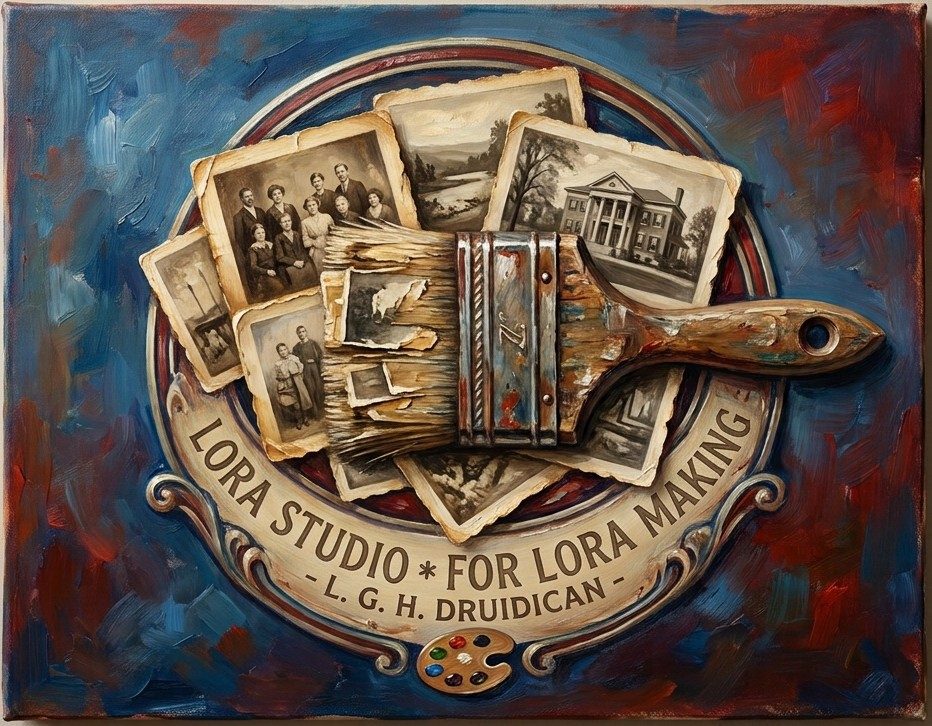
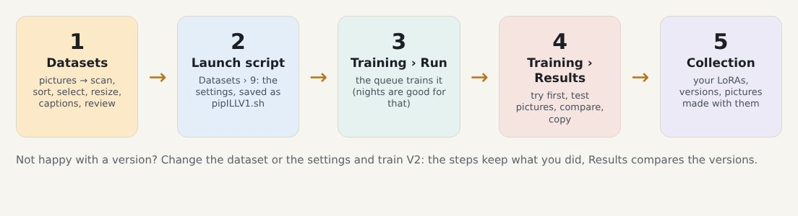
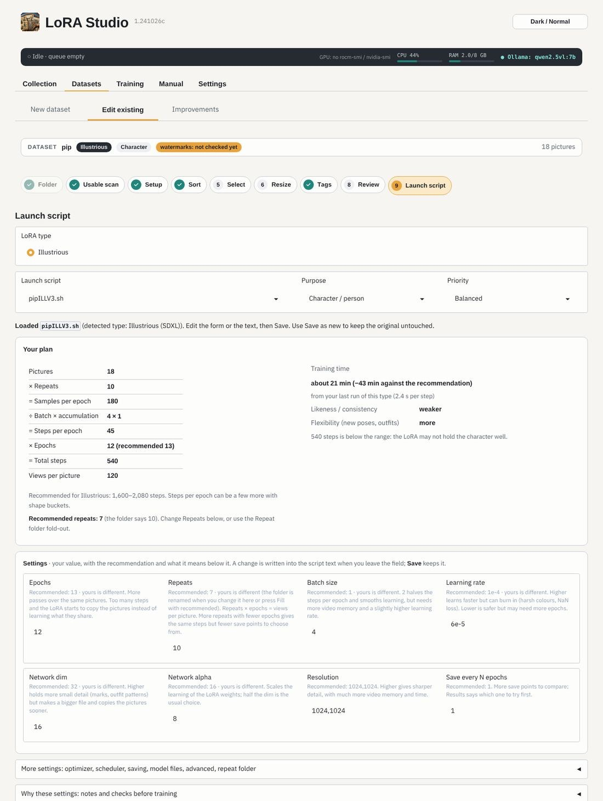
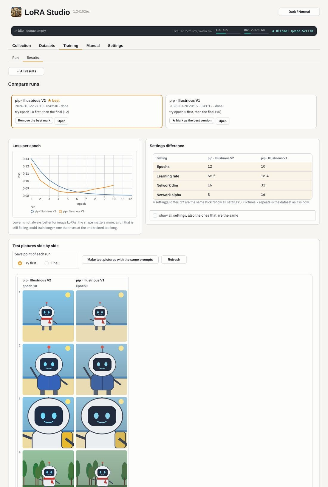

<p align="center"></p>

# LoRA Studio

I found that making LoRAs on my system was a bit of a challenge, and remembering and keeping track of all the
settings, and watching the LoRAs while they were being trained, was a bit of a hassle. Some of the other tools out
there, although great, just didn't suit my way of doing things, so I decided to make a GUI to help me. It ended up
becoming a combined GUI for sd-scripts and musubi-tuner.

Since I do not know how to code myself, I have had Claude.ai help me. This of course might lead some to disregard
this GUI, for many reasons, and I do not blame you. But still, feel free to test it out, and I would welcome any
suggestions or corrections you may discover along the way.

*– Druidican*

LoRA Studio is a program for making your own **LoRAs** (small add-on models for image generators such as SDXL,
Illustrious, Pony, FLUX, Z-Image and Qwen-Image). It runs on your own computer and opens in your browser. It takes
you from a folder of pictures to a trained LoRA, and keeps your finished LoRAs in a collection with their test
pictures.

It does not train by itself: it prepares everything and runs the well-known trainers
[sd-scripts](https://github.com/kohya-ss/sd-scripts) and [musubi-tuner](https://github.com/kohya-ss/musubi-tuner)
for you. Ollama (optional) looks at the pictures and writes captions.

<p align="center"></p>

> **Made on Linux with an AMD Radeon (ROCm).** LoRA Studio was built and tested on Fedora with an RX 9070 XT. It is
> written to work on NVIDIA cards and on Windows (through WSL2) too, but those have not been tried on real hardware
> yet. **Testers wanted** for every other combination: NVIDIA on Linux, Windows with NVIDIA or AMD, laptops with two
> GPUs. The Manual chapter *Testing LoRA Studio* says what to try; send the result with the
> [Test result form](../../issues/new?template=test_result.yml). Thank you!

## What it does

- **Datasets**: nine steps from a folder of pictures to a launch script: a check for unusable pictures, sorting,
  choosing, resizing, captions (by hand or with Ollama), a review, and a launch script with tuned settings for your
  LoRA type and the number of pictures.
- **Training**: a queue, the live run (step, loss, time left), and **Results** for every run: which save point to try
  first, test pictures with your own ComfyUI workflow, two versions side by side, and a plain-words explanation when a
  run fails ("out of video memory: lower the batch size…").
- **Collection**: all your LoRAs with their pictures, versions and LoRA Manager data.
- **Settings**: a health check, the folders and model files, start and network options, backups, updates of LoRA
  Studio and the trainers, and a machine check that tests your GPU and does a tiny training.
- **Manual**: a guide with pictures inside the program.

<p align="center">
</p>

## What you need

- **Linux** (tested on Fedora), or **Windows 10/11** through WSL2 (the installer sets it up).
- To train: a graphics card, **AMD Radeon** with ROCm (tested on an RX 9070 XT, 16 GB) or **NVIDIA** with CUDA. The
  bigger models (FLUX, Qwen-Image) need more video memory than SDXL.
- About 25 GB of disk space with the trainers, 2 GB without.
- Optional: [Ollama](https://ollama.com) for sorting and captions, [ComfyUI](https://github.com/comfyanonymous/ComfyUI)
  for test pictures.

Without a usable GPU, LoRA Studio still prepares datasets and writes launch scripts that you run on another
computer. Parts you do not install are greyed out with *(… missing)* and cannot be started by mistake.

## Install

**Linux**

```bash
unzip LoraStudio.zip && cd LoraStudio
./install.sh
cd ~/LoraStudio && ./start.sh
```

**Windows**: unpack LoraStudio.zip and double-click **Install LoRA Studio.cmd**. It installs WSL2 with Ubuntu when
needed (one restart), runs the same installer inside it and puts a **LoRA Studio** starter on your desktop.

The installer asks three questions: **sd-scripts**, **musubi-tuner** and **Ollama**: install it for you, use the one
you have, or none. At the end it writes an **install report** (no passwords, tokens or home folder) that you can send
when something does not work. The first start opens a setup page in your browser for your folders; every step can be
skipped. More: the Manual chapter *Installing*, and [REFERENCE.md](REFERENCE.md#install-with-installsh-recommended).

## Updates

**Settings › Updates**: choose a newer LoraStudio.zip. LoRA Studio shows what changes, keeps a backup of the old
files, tests the new version and goes back by itself if the test fails. Your settings and data are never part of an
update. Versions are `release.ddmmyy` with a letter for later updates of that release (`1.261026`, `1.261026b`, …);
Settings › Version shows the version of every part.

Your own files (settings, token, marks, caches, logs) are all in `userdata/`, apart from the program in `program/`;
**Settings › Backup** puts them in one zip that the setup page of a new install can import.

## Your data stays yours

LoRA Studio runs only on your computer and has no account, no tracking and no upload. It goes online only for what
you ask for or turn on: model and Ollama downloads, trainer updates and the trainer update check at start (Settings ›
Start and network). Your Hugging Face token is stored readable only by you. To share the
program, give the zip, never your LoRA Studio folder: that holds your settings and your token.

## Help and testing

- When a training fails, Training › Results says what went wrong; **Report for Claude** (Settings › Version, or the
  *Report* button of a failed run) makes one file with the log end, the settings and the machine, without tokens or
  your home folder, to paste into a chat or send to someone who helps.
- Testers: the Manual chapter *Testing LoRA Studio* says what to try and what to send back.
- Everything in detail, page by page and file by file: [REFERENCE.md](REFERENCE.md).

## Licence

LoRA Studio is free software: you can redistribute it and/or modify it under the terms of the **GNU General Public
License, version 3** ([LICENSE](LICENSE)). It comes with no warranty.

Copyright © 2026 L. G. H. Druidican.

LoRA Studio uses, but does not include (see [NOTICE](NOTICE), also shown once at the first start): [sd-scripts](https://github.com/kohya-ss/sd-scripts) and
[musubi-tuner](https://github.com/kohya-ss/musubi-tuner) (Apache-2.0, by kohya-ss), [Gradio](https://gradio.app)
(Apache-2.0), [PyTorch](https://pytorch.org) (BSD), [Ollama](https://ollama.com) (MIT) and
[ComfyUI](https://github.com/comfyanonymous/ComfyUI) (GPL-3.0). The installer downloads them from their own sources.
