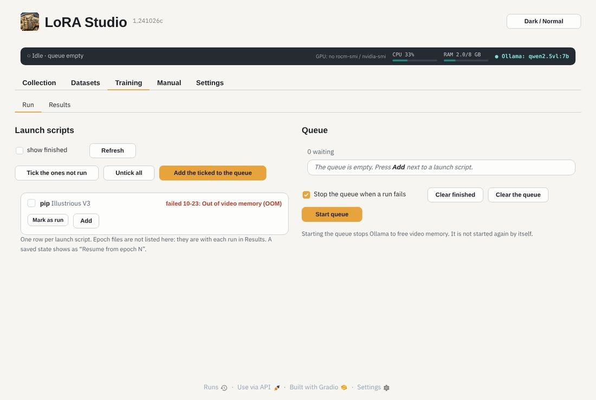
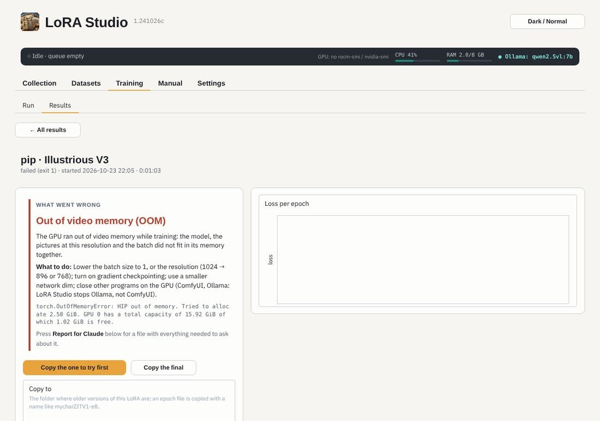

# Training

**Training › Run** lists one launch script per dataset and LoRA type, with when it last ran and how. Tick several and
*Add the ticked to the queue*, or press *Add* on one. *Start queue* trains them one after the other.

- The queue **stops Ollama** first, to free the video memory (it is not started again by itself).
- *Stop the queue when a run fails* is on by default: a failing script does not run the next ones on a broken setup.
- *Mark as run* hides a script you don't want to train again (a failed or never-run one).
- A saved state shows as *Resume from epoch N*: the run goes on from there.

## When a run fails

The end of a trainer log is long and hard to read. LoRA Studio reads it for you and says in a few words what went
wrong, what it means and what to do, in the queue, the top bar and on the run's page in Results.

| What LoRA Studio says | What usually helps |
|---|---|
| **Out of video memory (OOM)** | batch size 1, a lower resolution, gradient checkpointing, close ComfyUI |
| **Out of normal memory (RAM)** | close programs, 0–1 data loader workers, cache latents to disk |
| **The loss became NaN** | a lower learning rate, bf16 instead of fp16 |
| **A model file is missing or broken** | check Settings › Model files, download a broken file again |
| **The model does not fit this LoRA type** | pick the right base model for the type |
| **No pictures to train on** | the repeat folder `<N>_<dataset name>` must hold the pictures |
| **A picture is broken** | Datasets › 2 Usable scan finds it |
| **The GPU could not be used** | Settings › Version › Check this machine |
| **A program or Python package is missing** | check the venv in Settings › Trainers and GPU |
| **The trainer does not know an option** | Datasets › 9 › *Check flags against my trainer* |
| **The disk is full** | Results › *Clean up this run* frees epoch files and caches |
| **Many errors in a row** / **Python error** | press *Report for Claude* and ask about it |

**Report for Claude** (on the run's page, and in Settings › Version) makes one file with the version, the machine, the
diagnosis, the launch script and the end of the log, with your Hugging Face token and home folder removed. It is
copied too: paste it into a chat with Claude, or drop the file there.
