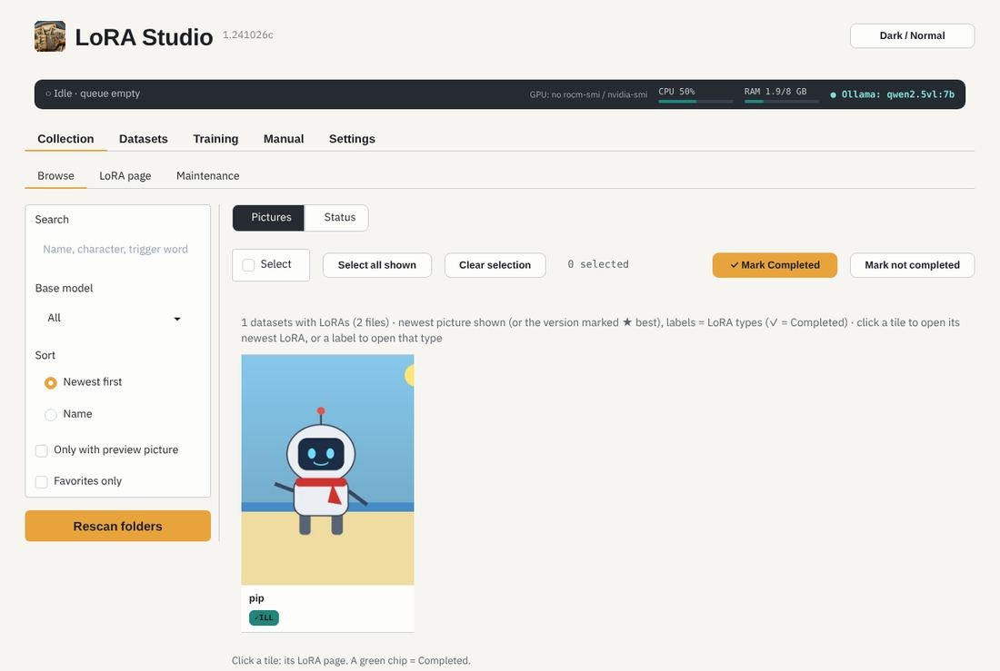
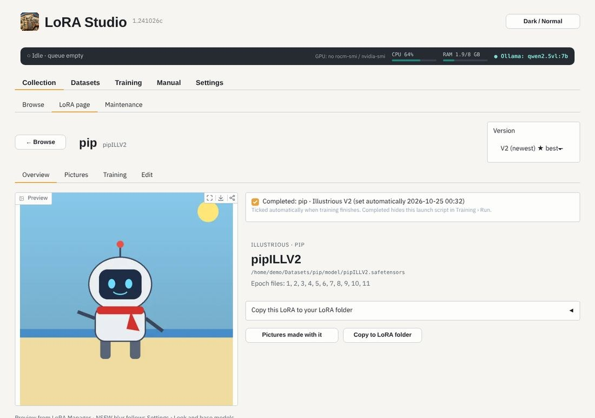

# The Collection

One tile per dataset with the picture of its newest (or ★ best) LoRA, and a label per LoRA type (✓ = Completed).

Click a tile for the **LoRA page**: the versions (the *Version* menu), the pictures you made with it in ComfyUI
(read from the pictures' own metadata), its training data, and Edit (name, trigger words, notes: saved in LoRA
Manager's format).

- **Completed** marks a version as finished: its launch script is hidden in Training › Run. A new version starts
  unmarked.
- **Maintenance** syncs LoRA Manager data and previews, and cleans up leftovers of finished runs.
