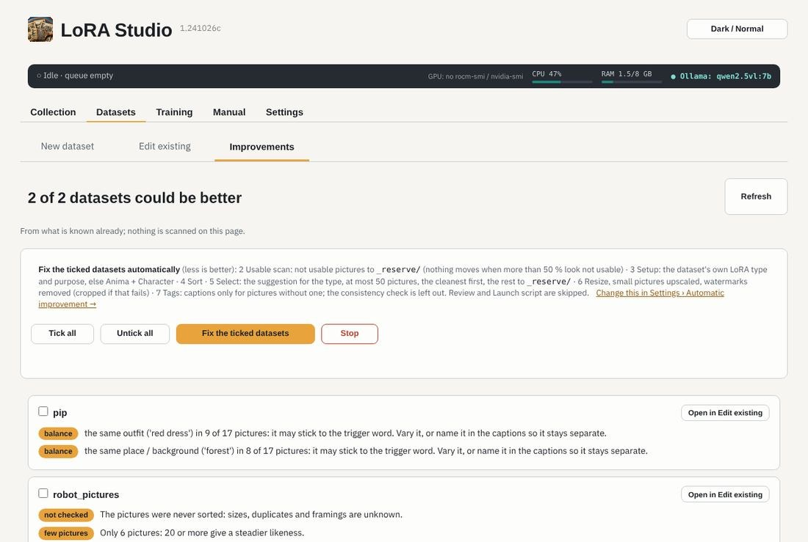
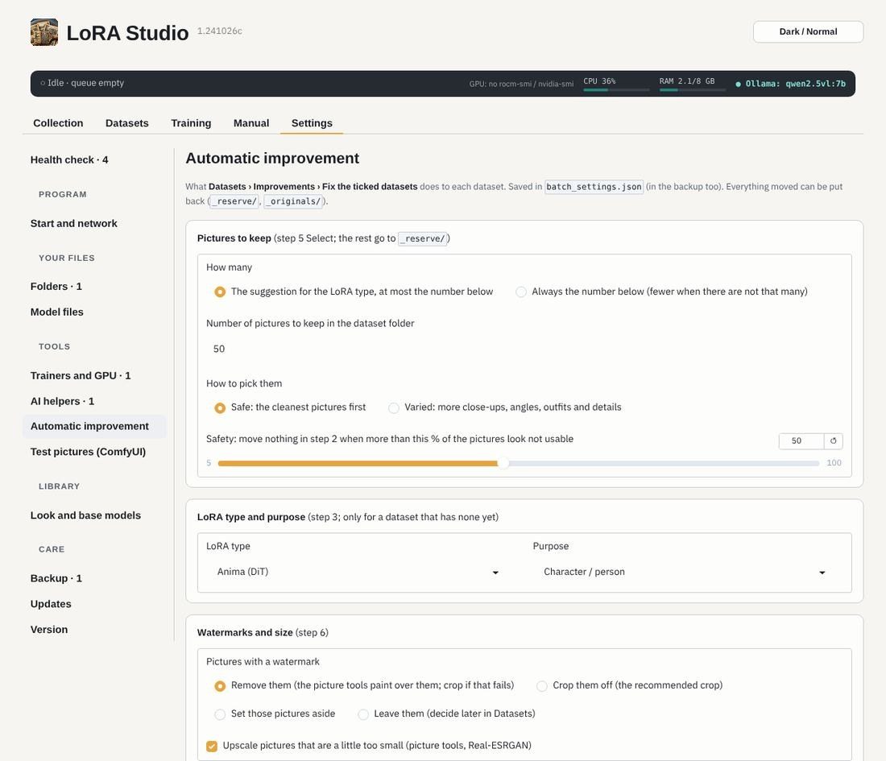

# Automatic improvement

**Datasets › Improvements** lists what could be better in each dataset, from what is known already (nothing is
scanned there): too many pictures, no full-body pictures, missing captions, watermarks not decided, no launch script.

*Fix the ticked datasets* runs steps 2 to 7 for each ticked dataset in the background, with the choices in
**Settings › Automatic improvement**:

> **Do** look at the result of an automatic run once (step 5 and step 8) before training on it.
> **Don't** let it run on a dataset you are editing by hand at the same time.
