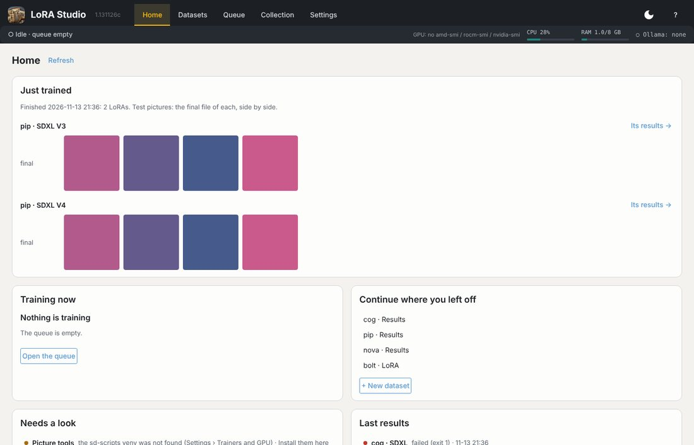

# Welcome

LoRA Studio takes you from a folder of pictures to a trained LoRA, and keeps your LoRAs, their versions and the
pictures you made with them in one place. This manual shows how, with an invented example: **pip**, a small robot.
Everything you see here (pictures, runs, losses) is made-up test data.

## The tabs

| Tab | What it is for |
|---|---|
| **Home** | The start page: what you just trained (with its test pictures), what is training now, what needs a look (setup, datasets, LoRA files), the last results and the datasets you worked on last |
| **Datasets** | Your datasets (+ New dataset) and Improvements. Each dataset has its own page with four parts: **Prepare** (steps 1-8, from a folder of pictures to captions), **Train** (the launch script and its place in the queue), **Results** (its runs: what to try first, comparing versions, your rating) and **LoRA** (its LoRA files) |
| **Queue** | All launch scripts, the queue and the run that is training now |
| **Collection** | Your finished LoRAs: one tile per dataset (a click opens the dataset page's LoRA part), the LoRA page with versions, pictures made with it, its training data; Insights (what your own runs say); Maintenance (sync with LoRA Manager) |
| **Settings** | Folders, model files, trainers and GPU, Ollama, ComfyUI, backups, updates, version |

**?** at the top right opens this manual at the chapter of the page you are on, with all chapters on the left; *Close* takes you back to where you were.

## The bar at the top

It is the same on every page: what is training now (step, loss, time left), how busy the GPU, CPU and RAM are (AMD:
from `amd-smi` with ROCm 10 and newer, `rocm-smi` before; NVIDIA: `nvidia-smi`), and
which Ollama model sits in video memory (Settings › AI helpers starts and stops it). The moon button at the top right
switches between dark and light. When a run ends it says so, with the save point to try first, or what went
wrong. Click it to go to the queue, or to the finished run in its dataset's Results.

## Just trained

When training ends, Home's **Just trained** card shows what came out, with a direct way to its test pictures:

- **One LoRA trained**: test pictures of its best save point (the one Results suggests trying first) and of the final
  file, side by side.
- **Several LoRAs trained** (a queue): the final file of each, together on one page.

*Make test pictures* makes them with ComfyUI (Settings › Test pictures) when they were not made by themselves; *Its
results →* opens the run in Results. A click on a picture shows it large.

## Where to start

1. [First start and settings](#settings): folders, model files, the Health check.
2. [Making a dataset](#datasets): the dataset page and its steps, with what to do and what not to do in each.
3. [Training](#training) and [Results](#results): the queue, reading a failed run, picking the best version.
4. [Do and don't](#do-and-dont): the short list worth reading once.
5. [The Collection](#collection), [Updates and backups](#care) and [Installing](#install) when you need them.
