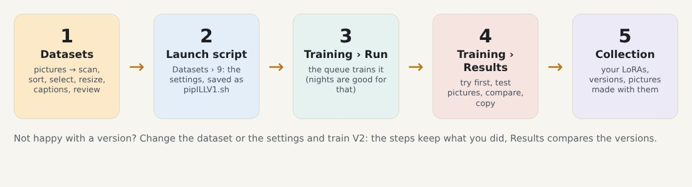
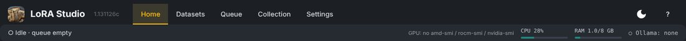

# Welcome

LoRA Studio takes you from a folder of pictures to a trained LoRA, and keeps your LoRAs, their versions and the
pictures you made with them in one place. This manual shows how, with an invented example: **pip**, a small robot.
Everything you see here (pictures, runs, losses) is made-up test data.

## The tabs

| Tab | What it is for |
|---|---|
| **Collection** | Your finished LoRAs: one tile per dataset, the LoRA page with versions, pictures made with it, its training data; Insights; Maintenance (sync with LoRA Manager) |
| **Datasets** | Making and improving the training pictures, in nine steps, ending with the launch script; Improvements |
| **Training** | **Run**: the launch scripts and the queue. **Results**: every finished run, what to try first, comparing versions |
| **Manual** | This guide |
| **Settings** | Folders, model files, trainers and GPU, Ollama, ComfyUI, automatic improvement, backups, updates, version |

## The bar at the top

It is the same on every page: what is training now (step, loss, time left), how busy the GPU, CPU and RAM are, and
which Ollama model sits in video memory (Settings › AI helpers starts and stops it). *Dark / Normal* at the top right
switches between dark and light. When a run ends it says so, with the save point to try first, or what went
wrong. Click it to go to Training › Run.

## Where to start

1. [First start and settings](#settings): folders, model files, the Health check.
2. [Making a dataset](#datasets): the nine steps, with what to do and what not to do in each.
3. [Training](#training) and [Results](#results): the queue, reading a failed run, picking the best version.
4. [Do and don't](#do-and-dont): the short list worth reading once.
5. [The Collection](#collection), [Updates and backups](#care) and [Installing](#install) when you need them.
