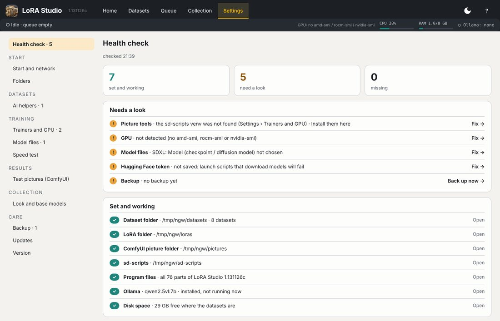
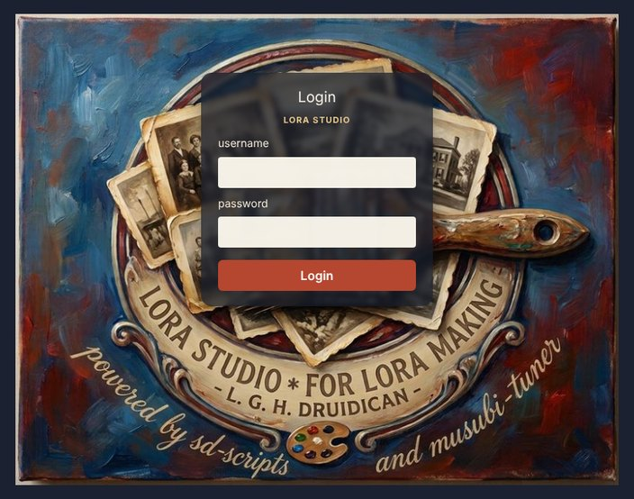
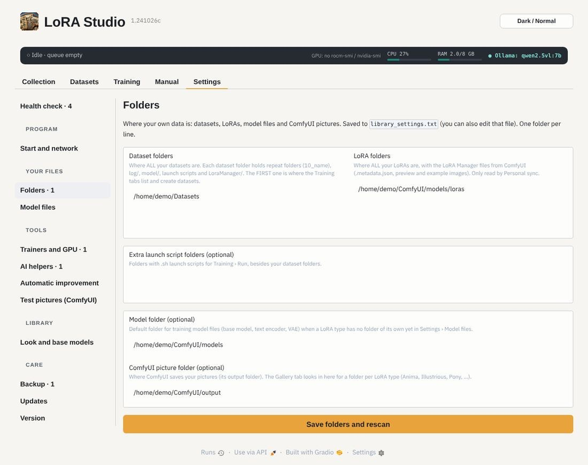
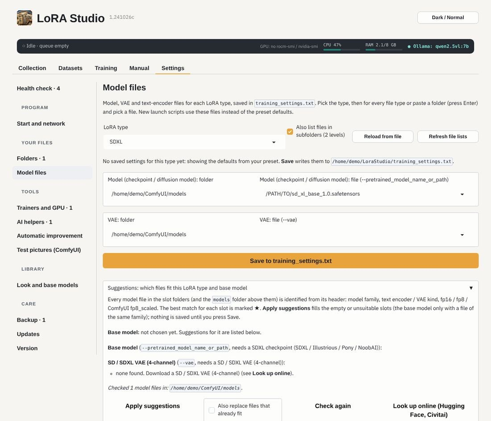
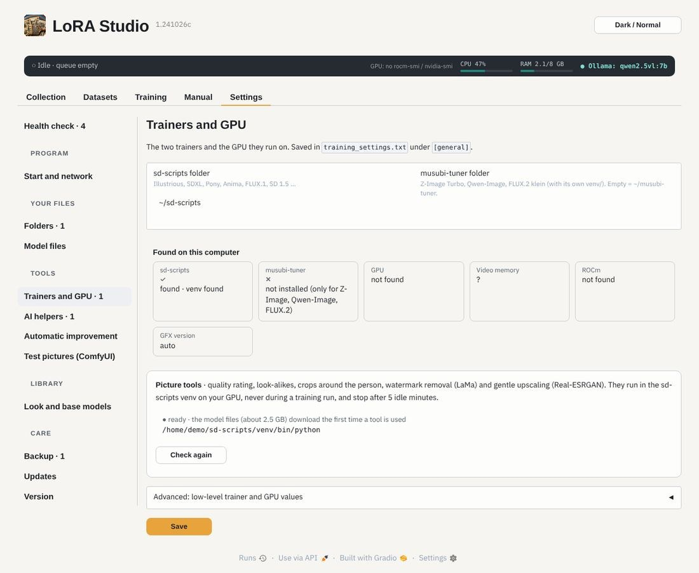
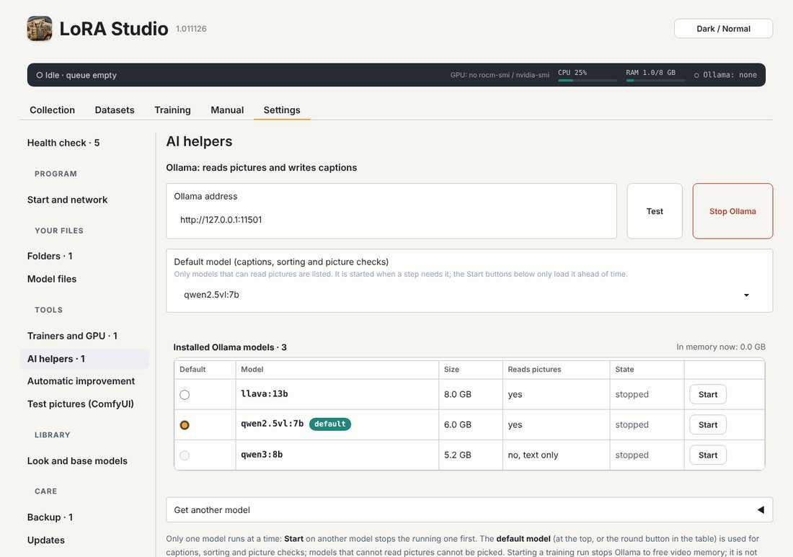
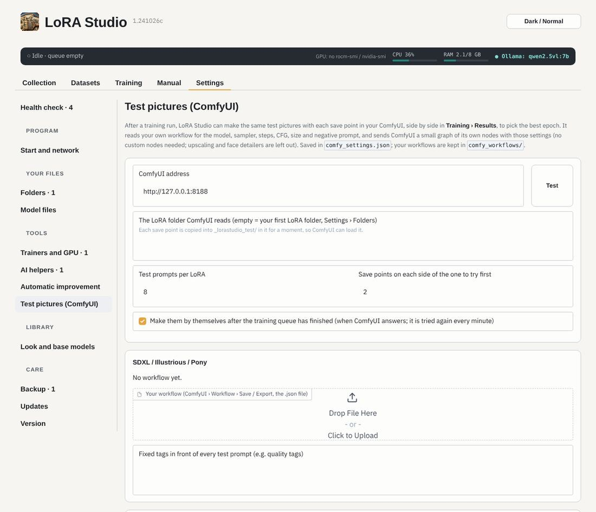

# First start and settings

## The first start

The very first page is a short **notice**: sd-scripts and musubi-tuner belong to kohya-ss, and LoRA Studio is a GUI
for them. Tick *I have read this and agree* and press *Continue to LoRA Studio*; it is shown only once.

Then the **setup page** asks seven things, one at a time: the trainers, your dataset folder, your model folder,
ComfyUI (the LoRA folder and the picture folder; installs it finds are offered), a Hugging Face token (*Test the
token* checks it), Ollama (*Look for models* lists the ones you have) and the backup folder. **Every step can be
skipped** and changed later in Settings. Moving from another computer? Open **Import from a backup** at the top and
pick a backup zip: your settings come back and LoRA Studio starts. *Settings › Health check › Run the setup page again*
shows it again later (or `./start.sh --setup`).

## Settings

**Settings** has a list on the left, grouped like the work: Start, Datasets, Training, Results, Collection and Care. A number next to an item
says how many things need a look there. It opens on the **Health check**.

Each line that needs a look has a link straight to the place where it is fixed. *Check again* reads everything anew.

## Start and network

How LoRA Studio starts: the port, whether the browser opens, the start page. Tick *Reachable on the network* to open
LoRA Studio from another computer or a tablet; it then needs a **login** (a user name and a password), asked for on
the painted logo:

*Save and restart* uses it at once; `./start.sh` and the desktop starter use it from then on (an option typed on the
command line still wins). The same page has **What is installed**: see [Installing](#install).

## Folders

- **sd-scripts folder**: where the trainer is (with its `venv/`).
- **Dataset folders**: one folder per dataset inside them (for example `~/Datasets/pip/`). New datasets are made in
  the first one. Several folders: one per line.
- **LoRA folders**: where ComfyUI reads LoRAs, together with LoRA Manager's files. Finished LoRAs are copied there
  from a dataset's Results, into the folder of their LoRA type.
- **Extra launch script folders** (optional), the **Monitor sample folder** and the **Model folder** (where the
  model file lists start).
- **ComfyUI picture folder**: where ComfyUI saves pictures, so the LoRA page can show the ones made with a LoRA.

*Save folders and rescan* reads the Collection again with the new folders.

## Model files

Pick the files once per LoRA type (Illustrious, SDXL, Anima, …): the base model, VAE and text encoders. New launch
scripts use them. *Refresh file lists* reads the folders again; *Reload from file* takes what is in the settings file.

- **Suggestions: which files fit**: every model file is read from its header (model family, text encoder or VAE
  kind, fp16 / fp8); the best match for each slot is marked ★. *Apply suggestions* fills the empty or unsuitable
  slots; nothing is saved until you press *Save*. *Look up online* opens the file's page on Hugging Face or Civitai.
- **A file you don't have yet**: next to a missing file there is **⬇ From Hugging Face**: it downloads the usual file
  for that slot into your models folder and fills the slot. *⬇ Download all missing files* does it for the whole
  type, *Stop download* stops (a download goes on from where it stopped next time). With your Hugging Face token
  (AI helpers, below) gated models work too, once you have accepted their licence on huggingface.co. For another
  file, open *Download any file from Hugging Face* and paste the file's link.
- **LoRA subtypes** (for example Pony): a subtype trains exactly like its base type but has its own model files and
  file tag (`pipPONYV1`). *Add subtype*, then pick it as LoRA type above and choose its files.

> **Don't** pick a model of another family (an SD 1.5 checkpoint for SDXL, a VAE as the checkpoint): the run fails
> with "The model does not fit this LoRA type".

## Trainers and GPU

The sd-scripts and musubi-tuner folders and their venv, and the GPU (*Detect GPU*; AMD: the gfx version). If you
installed with `install.sh` and chose *use my own trainers*, these point at your folders and venv.

- **Picture tools**: quality rating, look-alikes, crops around the person, watermark removal and gentle upscaling.
  They run in the sd-scripts venv on your GPU, never during a training run, and stop after 5 idle minutes. *Install
  the picture tools* adds what is missing.
- **Advanced: low-level trainer and GPU values**: environment values for the trainers (*Save environment*), and
  *Update all launch scripts* writes changed values into the scripts you already have.

## Speed test

Which settings make each LoRA type train fastest on **your** computer? The table lists every LoRA type: whether it
can be tested (its model files and trainer are there), its last test (how fast it trains now, and the fastest that
was found) and whether the faster settings are in use.

- Tick the types to test, choose how thorough (*Quick*, *Full*, or *Only how fast it trains now*) and press *Start
  the speed test*. Test a few types now and others later: every result is kept.
- Each type trains a few steps on an invented test dataset (20 plain pictures; none of your datasets is used) with
  one setting changed at a time: fewer swapped blocks, pinned memory for block swapping, no gradient checkpointing,
  other attention (sage, flash, xformers), fp8, torch.compile, and the ROCm settings TunableOp, MIOpen fast search and
  expandable memory. Only what your sd-scripts or musubi-tuner support is tried. A setting that runs out of memory or
  gets a NaN loss is reported as such; then the faster ones are tried together.
- **Results**: pick a type to read its report (each setting with seconds per step, the change against now and the
  video memory). Tick **Use the faster settings for new launch scripts of this type** to make every new launch
  script of that type use the fastest result; your existing scripts stay as they are (make a new version in step 9).
  Untick to go back. A later test of the same type updates the settings in use.
- Close ComfyUI before a test; Ollama is stopped by itself. The training queue does not start while a test runs,
  and a test does not start during a training run. *Stop* ends it after the running step.

## AI helpers

**Ollama** reads pictures and writes captions. Set its address and press *Test*. The **default model** (the menu at
the top, or the round button in the table) is used for captions, the sort and the picture checks; only models that
can read pictures can be the default. The table shows every installed model with its size and whether it is in
memory: **Start** loads one ahead of time (only one runs at a time, so the running one stops first), **Stop** frees
the memory, *Stop Ollama* stops all. *Get another model* downloads one by name (for example `qwen2.5vl:7b`) or removes
one. Starting a training run stops Ollama to free video memory; it is not started again by itself. The top bar always
shows which model is running.

**Hugging Face token**: for gated models and the downloads above (a *Read* token is enough). It is kept readable only
by you, written into launch scripts that download models, and masked in the run log.

## Test pictures (ComfyUI)

The ComfyUI address (*Test* checks it) and your LoRA folder as ComfyUI sees it. Import your own ComfyUI workflow per
model family once (Workflow › Save in ComfyUI). LoRA Studio then makes test pictures with every save point of a run,
with the same model, sampler and size as your workflow: how many prompts, and whether they are made by themselves
when a run ends.

**Upscale workflow** (dataset pictures): your own ComfyUI workflow for the Detailed scan's upscales, sharpening and
detail crops, for example **SeedVR2** (with a GGUF model if your video memory needs it). Save it in ComfyUI (*Workflow ›
Save*, or *Export (API)*) and drop the file here. It runs as it is; LoRA Studio only puts each picture into its *Load
Image* node and takes the result from its *Save Image* node. In a *SeedVR2 Video Upscaler* node it also sets:

- the **size**: the short side the LoRA type trains at, and a cap for the long side;
- the **noise** (*Automatic*): none for sharpening at the same size; input noise 0.1 up to 0.4 the more a picture grows
  (it hides the blocks and smearing of small sources); a little latent noise above 3×, which can soften detail.
  *The workflow's own values* leaves them as you set them.

Before an upscale, LoRA Studio unloads the Ollama models, so the two don't share the video memory.

## Look and base models

How the Collection looks and how it tells which base model a LoRA was trained on:

- **Base models**: `Name = keywords`, checked top to bottom against a LoRA's own data (for example
  `Illustrious = illustrious, nova`).
- **NSFW previews**: blur them (hover to show), from which level, and also when the level is unknown.
- **Colour the Collection cards by purpose**: a border and a label in the colour of the purpose (character, art
  style, object, worn item, action / pose, concept). Pick the colours and press *Save colours*; *Default colours* goes back; off
  keeps every card white.
- *Dark / Normal* at the top right of every page switches between dark and light.

## Backup, Updates and Version

See [Updates, backups and the machine check](#care).
