# Making a dataset

**Datasets › New dataset** starts with a folder of pictures. LoRA Studio makes the dataset folder with one repeat
folder `<N>_<name>` (for example `10_pip`): **only that folder is the dataset**. Pictures anywhere else in the
dataset folder (`_reserve/`, `_extra/`, other folders) are left out of every count and check, so they never give
false warnings.

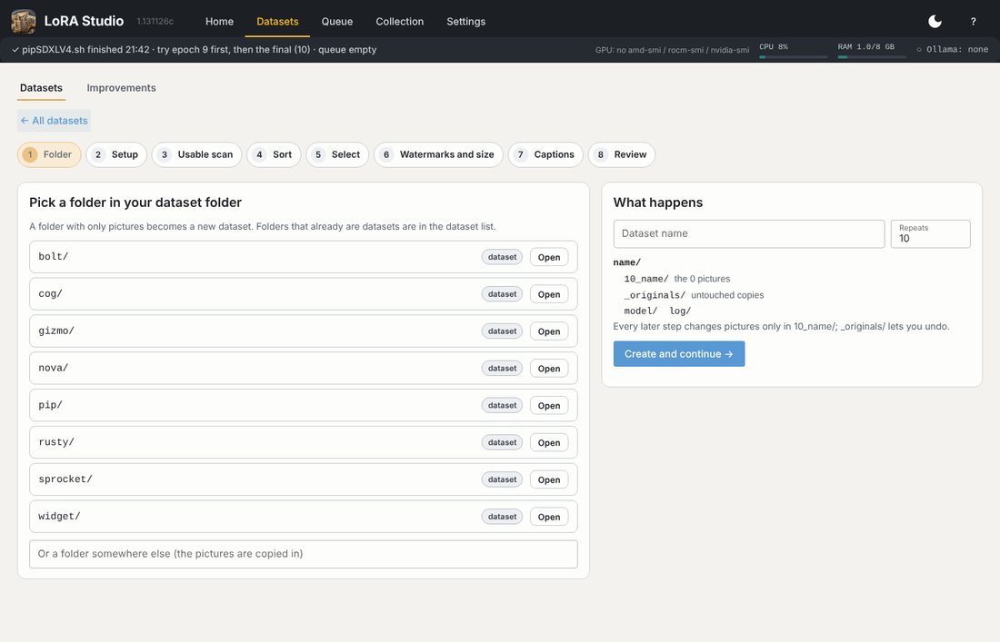

**Edit existing** lists your datasets with their next step; open one to see every step and its state.

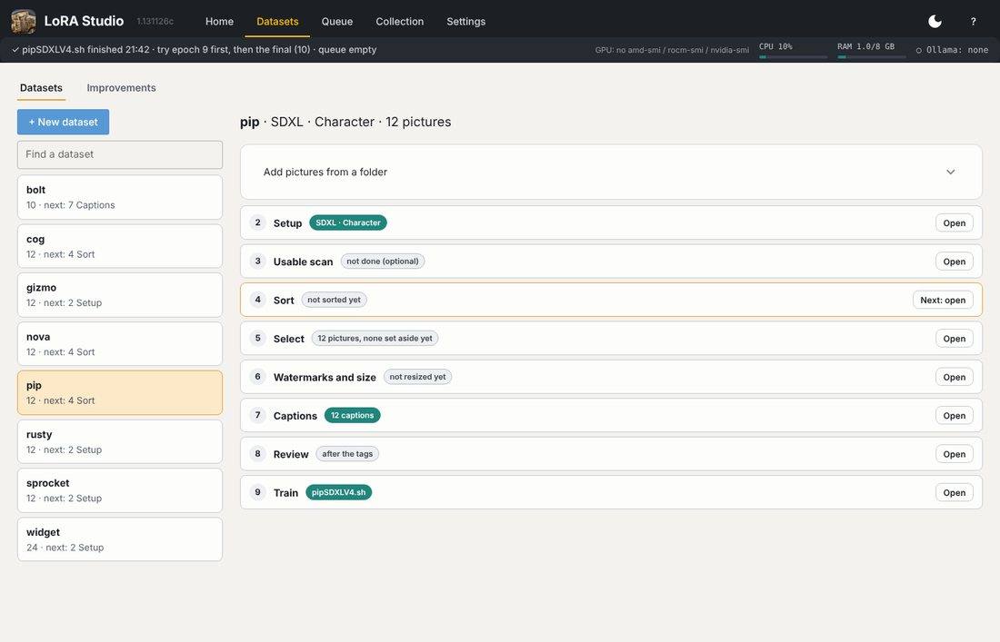

## What makes good training pictures

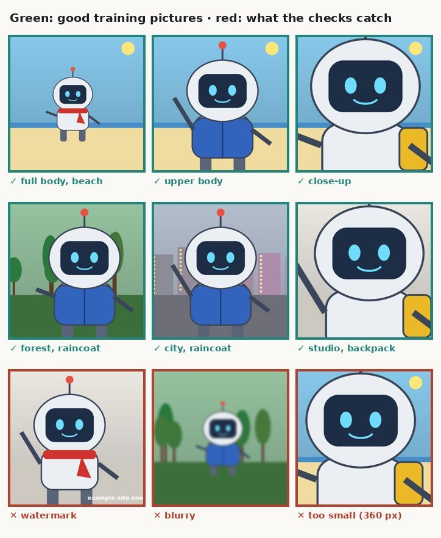

For a character: **20–40 pictures**, the same character, different framings, outfits, places and light. Fewer good
pictures beat many similar ones. For a style: 30–80 pictures in that style with different subjects.

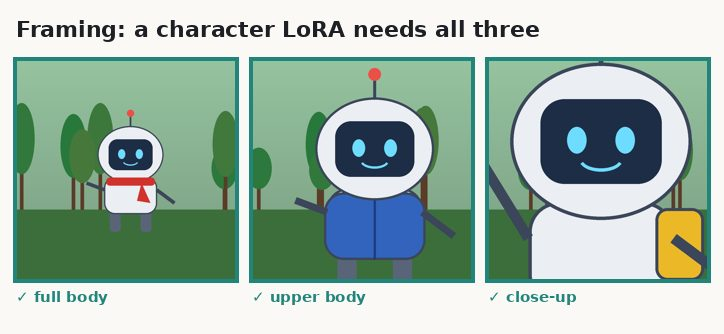

## 2 · Usable scan

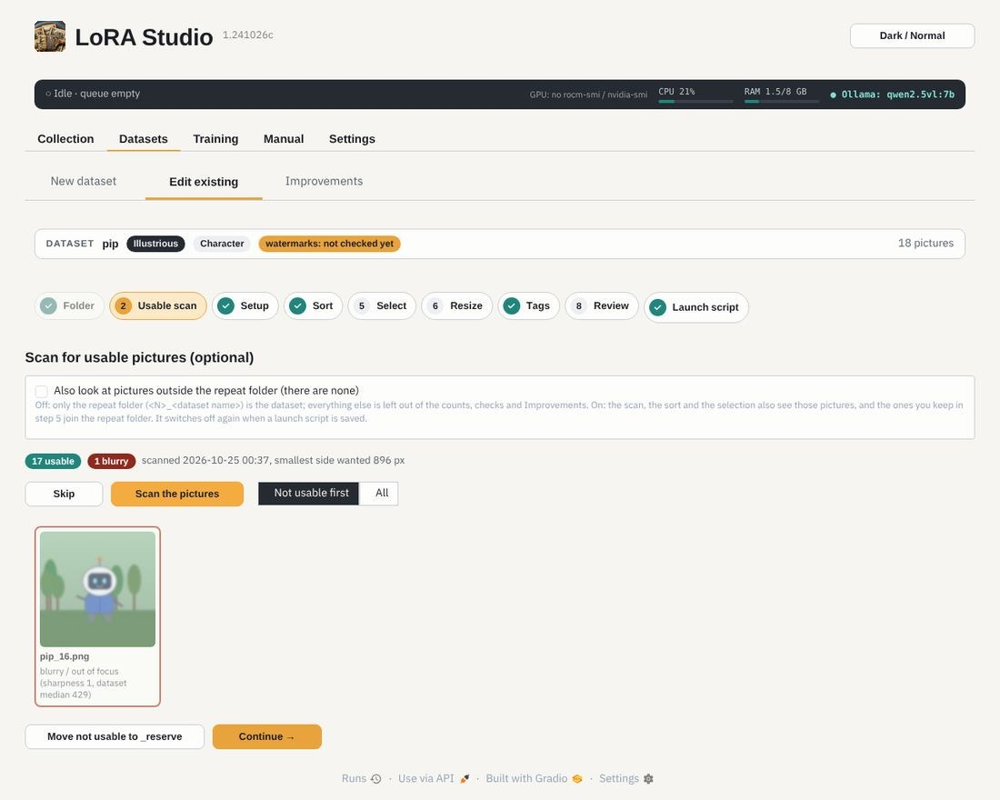

Finds pictures that are too small for the LoRA type, blurry, broken or duplicates. *Move not usable to _reserve*
moves them out (never deletes). Tick *Also look at the pictures outside the repeat folder* to let steps 2, 4 and 5
see pictures in `_reserve/` and other folders too: the ones you keep in step 5 join the repeat folder.

## 3 · Setup

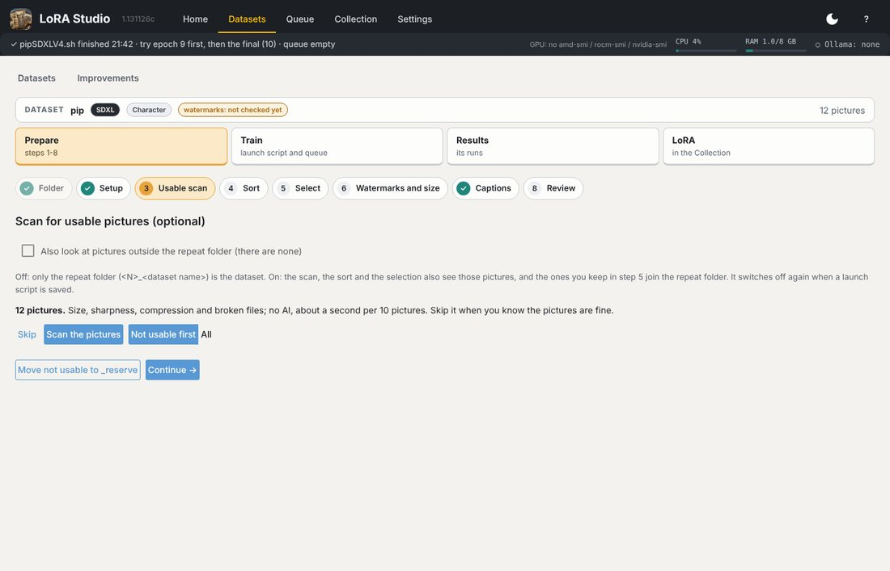

- **LoRA type**: the base model family (several are fine: one caption set and one launch script per type).
- **Purpose**: character, style, object, action or concept. It decides how the captions are written.
- **Trigger word**: the first word of every caption, the word you put in a prompt to call the LoRA (`pip`).

## 4 · Sort

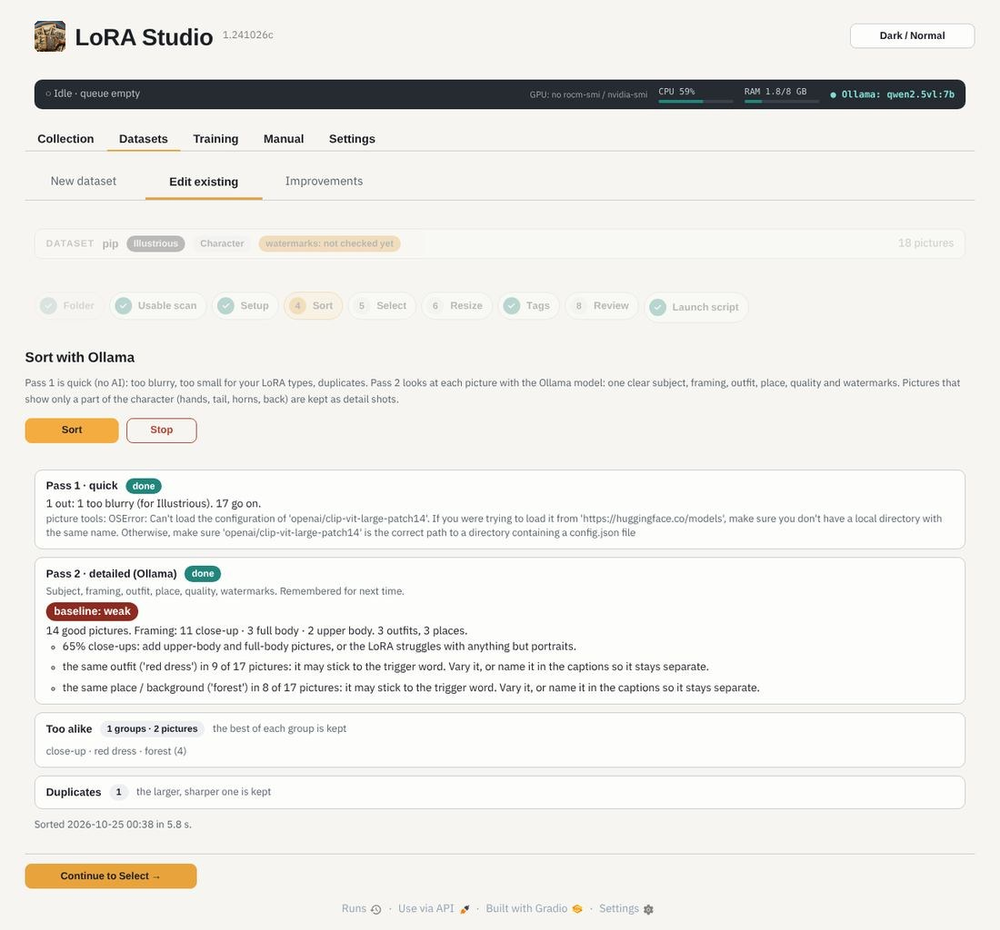

Pass 1 (no AI) removes what is too small, blurry or a duplicate. Pass 2 asks the Ollama vision model about every
picture: one clear subject, framing, outfit, place, quality, watermarks, and how much the picture shows of the
subject. A picture that teaches almost nothing (the subject tiny, hidden or lost in the background) is left out; one
that shows a detail well (a tattoo, jewellery) ranks higher. For a character, a picture is also left out when clothes,
pose or angle hide nearly everything about the character, when the figure is small and the face tiny, or when it shows
only plain hands or feet (a tail, horns or a tattoo stay as detail shots). Sharpness only decides between pictures
that show the character equally well. It takes about a second or two per picture.

## 5 · Select

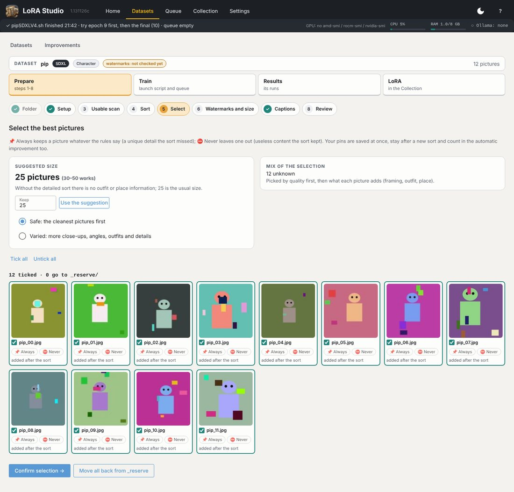

A suggested number of pictures for the type and purpose, and a selection: **Safe** takes the cleanest pictures first,
**Varied** more close-ups, angles, outfits and details. Untick what you don't want; *Confirm selection* moves the rest
to `_reserve/` (you can swap them back any time).

The sort can still be wrong. Under each picture: **📌 Always** keeps it whatever the rules say (a unique detail the
sort dropped), **⛔ Never** leaves it out (useless content the sort kept). Pins are saved at once, stay after a new
sort and count in the automatic improvement too; click a pin again to remove it.

## 6 · Watermarks and size

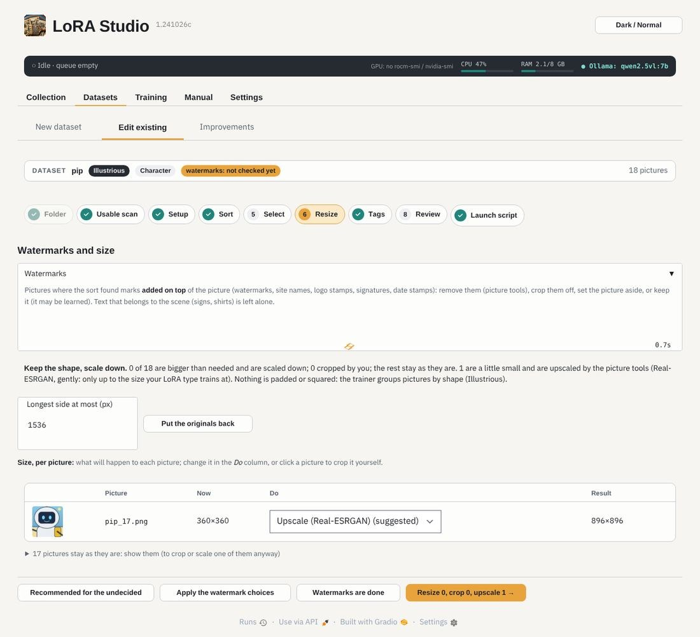

Watermarks found by the sort: remove them (the picture tools paint over them), crop them off, set the picture aside or
keep it. Then the size: pictures bigger than needed are scaled down, never squared or padded. The originals stay in
`_originals/`.

## 7 · Tags (captions)

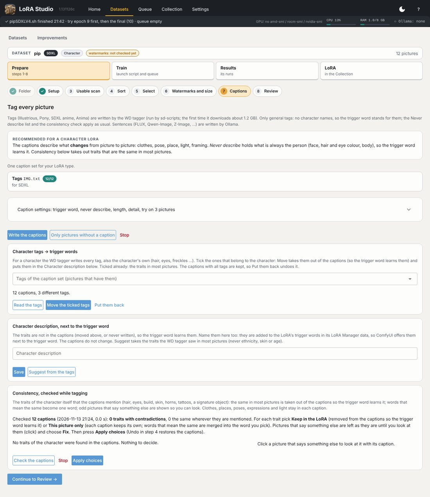

Writes a caption for every picture. **Tags** (Illustrious, Pony, SDXL, Anima) come from the **WD tagger**
(wd-eva02-large-tagger-v3, run by sd-scripts; no Ollama needed, about 1.2 GB downloaded the first time); **sentences**
(Z-Image, FLUX, Qwen-Image) come from Ollama.
For a character, captions describe what **changes** (clothes, pose, place) and leave out what is always the
character, so the trigger word learns it. The consistency check finds traits that are named in different ways.

**Character description**: name those traits in words too (*slim build, tall, blonde hair, blue eyes*). They are put
next to the trigger word in the LoRA's LoRA Manager data, so ComfyUI offers them with it and you can add them to a
prompt to make the character stronger. The captions stay as they are. *Suggest from the tags* fills in what the WD
tagger saw in most pictures; add build and height yourself.

## 8 · Review

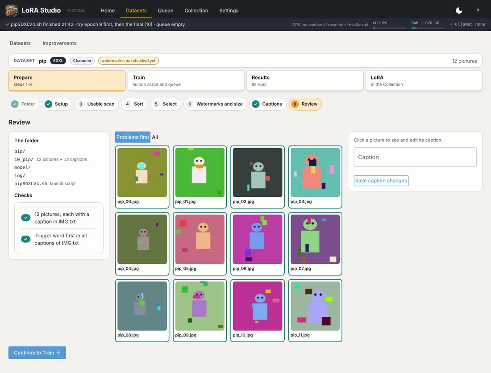

The last look: pictures without a caption, captions without the trigger word first, very long captions. Click a
picture to see and edit its caption.

## 9 · Launch script

The recommended settings for the type, purpose and number of pictures, with what each one means. Change a field and
the plan (steps, time) follows. **Save as new version** writes `pipILLV1.sh`, the next one `pipILLV2.sh`; older
scripts move to `_old_runs/`. *Add to the queue* sends it to Training › Run.
