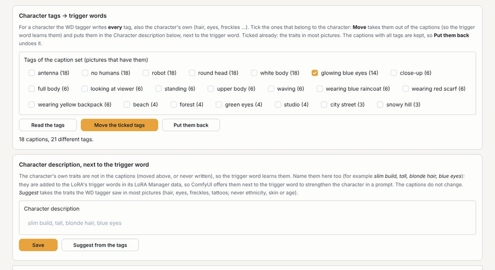
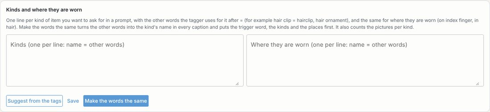
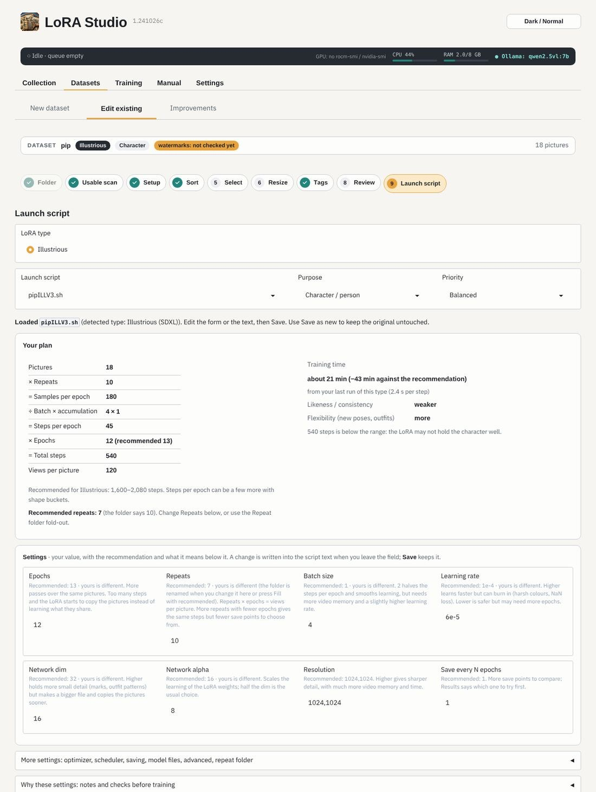

# Making a dataset

**Datasets** has two pages: the **dataset list** (with **+ New dataset** on top) and **Improvements**, and the nine steps.
A dataset is one folder with one repeat folder `<N>_<name>` (for example `10_pip`): **only that folder is the
dataset**. Pictures anywhere else in the dataset folder (`_reserve/`, `_extra/`, other folders) are left out of every
count and check, so they never give false warnings.

## 1 · Folder (+ New dataset)

Pick a folder in your dataset folder. A folder with only pictures becomes a new dataset: LoRA Studio makes the repeat
folder and moves the pictures in (*Create and continue*). Folders that already are datasets are in the dataset list.

The **dataset list** shows your datasets with their next step; open one to see every step and its state.

**Add pictures from a folder** (an open dataset, above its steps): pictures that are good enough and not already in the dataset are
copied into its repeat folder (and into `_originals/`). Then sort and select again.

## What makes good training pictures

For a character: **20–40 pictures**, the same character, different framings, outfits, places and light. Fewer good
pictures beat many similar ones. For a style: 30–80 pictures in that style with different subjects.

## 2 · Setup

- **LoRA type**: the base model family. Several are fine: sorting uses the strictest size, step 7 writes one caption
  set per caption style, step 9 one launch script per type.
- **Captions for Anima, FLUX and Chroma** (shown when one of them is ticked): these models read both tags and
  sentences. *Each type's usual style* gives Anima tags and FLUX / Chroma sentences; *Tags* or *Sentences* gives them
  that one; *Both* makes step 7 write a tag set **and** a sentence set, and step 9 asks which one each launch script
  trains on.
- **Purpose**: character, style, object, **worn item**, action or concept. It decides how the captions are written
  and how the pictures are judged. A **worn item** is clothes, equipment or jewelry that people wear (a collection of
  rings and hair clips, a jacket, an armour); pick which of the three, so step 7 knows which tags describe the item.
- **Trigger word**: the first word of every caption, the word you put in a prompt to call the LoRA (`pip`).
- **Class word** (character): what the trigger word is, in one general word (`robot`, `person`, `cat`). Sentence
  captions (FLUX, Chroma, Z-Image …) then begin `pip, a robot, …`, so the text encoder knows what kind of thing the
  new word means, which helps likeness. Tag captions are not changed. Leave it empty to start with the trigger word
  alone.

**Ready for these LoRA types?** (the card on the right): for each ticked type, whether its model files are on this computer and its trainer is installed, and whether Ollama has a model that reads pictures (the sort and sentence captions need it). *⬇ Download the missing model files* fetches them from Hugging Face **in the background**: go on with the next steps meanwhile; the line under the button says how far it is.

## 3 · Usable scan

*Scan the pictures* finds pictures that are too small for the LoRA types you ticked in Setup, blurry, broken or duplicates. *Move not
usable to _reserve* moves them out (never deletes). Tick *Also look at the pictures outside the repeat folder* to let
steps 3, 4 and 5 see pictures in `_reserve/` and other folders too: the ones you keep in step 5 join the repeat
folder, and the setting switches itself off again when a launch script is saved.

## 4 · Sort

Pass 1 (no AI) removes what is too small, blurry or a duplicate. Pass 2 asks the Ollama vision model about every
picture: one clear subject, framing, outfit, place, quality, watermarks, and how much the picture shows of the
subject. A picture that teaches almost nothing (the subject tiny, hidden or lost in the background) is left out; one
that shows a detail well (a tattoo, jewellery) ranks higher. For a character, a picture is also left out when clothes,
pose or angle hide nearly everything about the character, when the figure is small and the face tiny, or when it shows
only plain hands or feet (a tail, horns or a tattoo stay as detail shots). Sharpness only decides between pictures
that show the character equally well. It takes about a second or two per picture. Without Ollama only pass 1 runs,
and step 5 then picks by quality alone.

**Detailed scan** (characters; tick it above *Sort*, it is remembered per dataset): after the sort, LoRA Studio
looks at the dataset as a whole. It asks the Ollama model once more per picture (angle, pose, expression, light, where
the face is and a detail worth a close-up) and counts framings, angles, poses, expressions, outfits, places and light
over the pictures the sort keeps. What is missing or rare is a **gap** (*Angle: side (none)*). It takes about twice
the time of the sort. It judges how well a picture shows things (visible, sharp, big enough, from which side), never
whose face it is.

## 5 · Select

A suggested number of pictures for the type and purpose, and a selection: **Safe** takes the cleanest pictures first,
**Varied** more close-ups, angles, outfits and details. When you have rated LoRAs, a line says what your good LoRAs of
this type had (pictures, close-ups, full body; see [Insights](#results)). Untick what you don't want; *Confirm
selection* moves the rest to `_reserve/`; *Move all back from _reserve* undoes it.

**Detailed scan** card (after a detailed scan): the gaps, the counts, and the suggestions, each with a thumbnail and
the reason. **Nothing happens until you tick a suggestion and press *Do the ticked***:

- ➕ **add**: a picture the sort left out that fills a gap; it gets an 📌 Always pin.
- ⤢ **upscale**: a kept picture smaller than the LoRA type needs, enlarged to the size it trains at (1024 px, 512 for
  SD 1.5).
- ✦ **sharpen**: a kept picture that is a little soft, run through the upscaler at the same size.
- ✂ **new picture of the face / a detail**: a small face or detail in a big picture is cut out as a **new picture**
  next to the original (`b07_face1.png`), upscaled when it is small, and pinned 📌 Always. It has no caption yet:
  step 7 *Only pictures without a caption* writes it.

Upscaling and sharpening use your **upscale workflow** in ComfyUI (Settings › Test pictures (ComfyUI)); without it,
upscales use LoRA Studio's own picture tools when they are installed, and sharpening waits. The originals, and the crops
as they were cut, stay in `_originals/`.

The sort can still be wrong. Under each picture: **📌 Always** keeps it whatever the rules say (a unique detail the
sort dropped), **⛔ Never** leaves it out (useless content the sort kept). Pins are saved at once, stay after a new
sort and count in the automatic improvement too; click a pin again to remove it.

## 6 · Watermarks and size

**Watermarks** found by the sort: remove them (the picture tools paint over them), crop them off, set the picture
aside or keep it. *Recommended for the undecided* fills in the ones you have not chosen; *Apply the watermark choices*
does it. Click a picture to paint over a watermark yourself (*Remove what I painted*).

**Size, per picture**: what will happen to each picture, in the *Do* column (scale down, crop, keep). Pictures bigger
than needed are scaled down, never squared or padded. Click a picture to crop it yourself: *Around the person*
suggests a crop, *Use this crop* keeps it. *Resize* does the lot. The originals stay in `_originals/`, and *Put the
originals back* undoes the step.

## 7 · Captions

**Write the captions** writes a caption for every picture; *Only pictures without a caption* fills the gaps; *Stop*
stops. **Tags** (Illustrious, Pony, SDXL, Anima) come from the **WD tagger** (wd-eva02-large-tagger-v3, run by
sd-scripts; no Ollama needed, about 1.2 GB downloaded the first time); **sentences** (Z-Image, FLUX, Qwen-Image) come
from Ollama. For a character, captions describe what **changes** (clothes, pose, place); what is always the character
belongs to the trigger word.

**Character tags → trigger words** (tags, character datasets): the WD tagger writes **every** tag, also the
character's own (hair, eyes, freckles …). The card lists all tags with the number of pictures that have them; the
character's traits in most pictures are ticked already, and you tick or untick the rest. **Move the ticked tags**
takes them out of every caption and puts them in the Character description; the captions with all tags are kept,
and **Put them back** undoes it. *Read the tags* reads the captions again after you changed them by hand.

**For a worn item** the same card is called **Item tags → trigger words**: the WD tagger writes every tag, also the
item's own look (metal, stones, pattern, material); the look words in many pictures are ticked already. A tag with a
kind in it (*gold ring*) leaves the kind (*ring*) when it moves. Above it, **Kinds and where they are worn**:

- One line per **kind** you want to ask for in a prompt, with the other words the tagger uses after `=`:
  `hair clip = hairclip, hair ornament`. The same for **where** they are worn: `on index finger`, `in hair`.
  *Suggest from the tags* fills both from what the captions say.
- **Make the words the same** turns the other words into the kind's name in every caption, adds the name where a
  tag mentions it (*gold ring* also gets *ring*), and puts the trigger word, the kinds and the places first. It counts
  the pictures per kind and warns when a kind is in fewer than a third of them (step 5 shows the same count): then
  the trigger word mostly means the others, so add pictures of it or give them more repeats in their own repeat
  folder.
- The person in the pictures is described in full (hair, face, the other clothes, pose, place), so the LoRA learns
  only the item. In ComfyUI you then write `lsjc, ring, on ring finger, …`.

**Character description**: the traits the trigger word learns, in words (*round glasses, red scarf, silver earrings*).
They are put next to the trigger word in the LoRA's LoRA Manager data, so ComfyUI offers them with it and you can add
them to a prompt to make the character stronger. *Suggest from the tags* fills in what the WD tagger saw in most
pictures; add what is missing, then *Save*.

**Caption settings** (the folded section): the length and detail of the captions, the **Never describe** list (what
sentence captions leave out for a character), and **Try on 3 pictures** to see the result first. *Undo last change*
puts the captions from before the last run back.

**Consistency, checked while tagging**: the traits of the character that the captions mention (hair, eyes, build,
skin, horns, tattoos, a signature object): the same in most pictures is taken out of the captions so the trigger word
learns it; words that mean the same (athletic, fit, toned) become one word; **odd pictures** that say something else
are shown so you can look. Clothes, places, poses, expressions and light stay. With two caption sets, *Apply to the
other caption set too* takes the same traits out of the second one.

## 8 · Review

The last look: pictures without a caption, captions without the trigger word first, very long captions. Click a
picture to see and edit its caption, then *Save caption changes*.

## 9 · Train

The recommended settings for the type, purpose and number of pictures, each with your value, the recommendation and
what it means. Change a field and the plan (steps, time) follows; *Use recommended* puts a value back, *Set epochs to
hit the target steps* adjusts the epochs. **More settings** has the optimizer, scheduler, saving, model files, the
advanced values and the repeat folder; **Why these settings** has the notes and the checks before training; **The
script text** shows the script itself.

- **Missing model files**: when a model file the script needs is missing, a card offers *⬇ Download from Hugging Face*
  for it (with your token for gated models). It downloads in the background, the same way as in step 2; when it is
  done, *Use model files from Settings* puts the files into a script that is already open.
- **From your own runs** (after a few rated LoRAs, see [Insights](#results)): *Your graphics card* warns when this
  batch size ran out of video memory before and estimates the time from your runs; *Your good LoRAs* shows their
  settings next to the recommendations; *Epochs* suggests fewer when your runs usually peaked early.

**Quality words**: a **Pony** LoRA type (a subtype with Pony in its name) trains with `score_9, score_8_up,
score_7_up, source_anime` in front of every caption, an **Illustrious** one with `masterpiece, best quality` behind
it. The launch script adds them while training (`--caption_prefix` / `--caption_suffix`, the caption files stay as
they are; for Pony `--keep_tokens` keeps them and the trigger word in front), and new sample prompts get them too
(an existing prompts file is kept as you wrote it).

**Character defaults per model** (since 1.091126; *Why these settings* explains each):

| LoRA type | Rank / alpha | Learning rate | Steps | Also |
|---|---|---|---|---|
| SDXL, Illustrious, Pony | 32 / 32 | 1e-4, text encoders 5e-5 | 1600–3000 | the text encoders learn the trigger word too; batch at most 4 |
| Anima | 16 / 16 | 1e-4 | 1200–2200 | |
| FLUX.1, Chroma | 32 / 32 | 1e-4 | 1600–3000 | without `--fp8_base` and with block swapping if results stay blurry |
| Z-Image Turbo | 32 / 32 | 1e-4 | 1600–3000 | with the training adapter; try *Discrete flow shift* 3.0 for weak likeness |
| Z-Image Base | 32 / 32 | 1e-4 | 1600–3000 | no adapter; the LoRA also works on Turbo (strength 1.0–1.5) |

Alpha is always the same as the rank: a lower alpha makes the LoRA learn at a fraction of its strength.

**Caption set for this launch script** (only when the dataset has a tag set and a sentence set that this LoRA type
can read): pick *Tags (IMG.txt)* or *Sentences (IMG.sentences.txt)*. It is written into the script
(`--caption_extension`) and remembered for the next version. Types that read only one style (Illustrious, Pony,
Z-Image …) always train on their own set.

**Save as new version** writes `pipILLV1.sh`, the next one `pipILLV2.sh`; older scripts move to `_old_runs/`.
**Save and add to the queue** saves the open script (or saves it as its new version when none is open) and puts it in
the queue. With *Start the queue when nothing is training* ticked (remembered), training starts at once and the status
strip at the top follows it; otherwise Training › Run starts the queue.

## Improvements

**Datasets › Improvements** lists what could be better in each dataset; see [Automatic improvement](#automatic).
