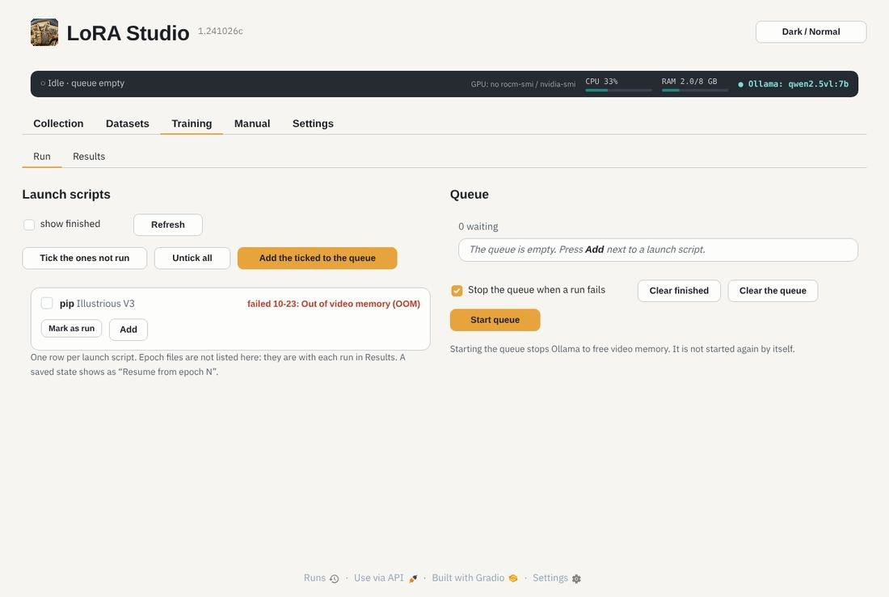
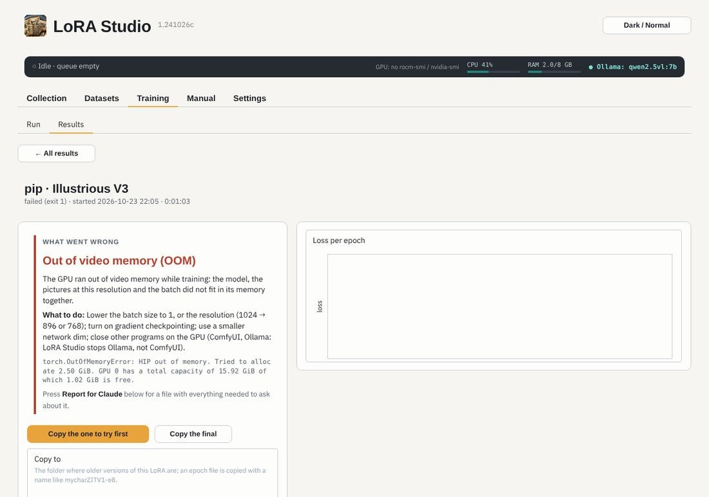

# Training

**Training › Run** lists one launch script per dataset and LoRA type, with when it last ran and how. Tick several and
*Add the ticked to the queue*, or press *Add* on one. *Start queue* trains them one after the other. (Datasets › 9 Train
can put a script in the queue and start it in one go.) When a run ends, the status strip says so; click it to open that
run in Results.

- The queue **stops Ollama** first, to free the video memory (it is not started again by itself).
- Each LoRA runs as its own program, so its memory is free again when it ends. When the next one uses another model
  (Anima → SDXL), the queue also asks ComfyUI to unload its models and waits until the video memory is empty; the
  queue note says how much was free. With the same model the next one starts at once.
- *Stop the queue when a run fails* is on by default: a failing script does not run the next ones on a broken setup.
- *Mark Completed* hides a script you don't want to train again (a failed or never-run one); *show finished* shows the
  hidden and Completed ones again.
- A saved state shows as *Resume from epoch N*: the run goes on from there.
- *Tick the ones not run* ticks every script that has not finished: never ran, failed, or stopped before its final LoRA was written (a run stopped with Ctrl+C can end without an error, but it still counts as not run and keeps its *Add* button); *Clear finished* empties the done part of the queue,
  *Clear the queue* all of it.

## The run

While a run trains, the page shows its stages (caching, training, saving), the progress (step, epoch, time left),
the **loss** curve and the save points written so far, the next item in the queue, and the **Run log** (folded).
**Stop after this run** lets the running LoRA finish and then stops the queue; **Stop now** stops it at once (a
saved state, if the script writes them, lets you resume later). The top bar shows the same on every page.

## When a run fails

The end of a trainer log is long and hard to read. LoRA Studio reads it for you and says in a few words what went
wrong, what it means and what to do, in the queue, the top bar and on the run's page in Results.

| What LoRA Studio says | What usually helps |
|---|---|
| **Out of video memory (OOM)** | batch size 1, a lower resolution, gradient checkpointing, close ComfyUI |
| **Out of normal memory (RAM)** | close programs, 0–1 data loader workers, cache latents to disk |
| **The loss became NaN** | a lower learning rate, bf16 instead of fp16 |
| **A model file is missing or broken** | check Settings › Model files, download a broken file again |
| **The model does not fit this LoRA type** | pick the right base model for the type |
| **No pictures to train on** | the repeat folder `<N>_<dataset name>` must hold the pictures |
| **A picture is broken** | Datasets › 3 Usable scan finds it |
| **The GPU could not be used** | Settings › Version › Check this machine |
| **A program or Python package is missing** | check the venv in Settings › Trainers and GPU |
| **The trainer does not know an option** | Datasets › 9 › *Check flags against my trainer* |
| **The disk is full** | Results › *Clean up this run* frees epoch files and caches |
| **Many errors in a row** / **Python error** | press *Report for Claude* and ask about it |

**Report for Claude** (on the run's page, and in Settings › Version) makes one file with the version, the machine, the
diagnosis, the launch script and the end of the log, with your Hugging Face token and home folder removed. It is
copied too: paste it into a chat with Claude, or drop the file there.
