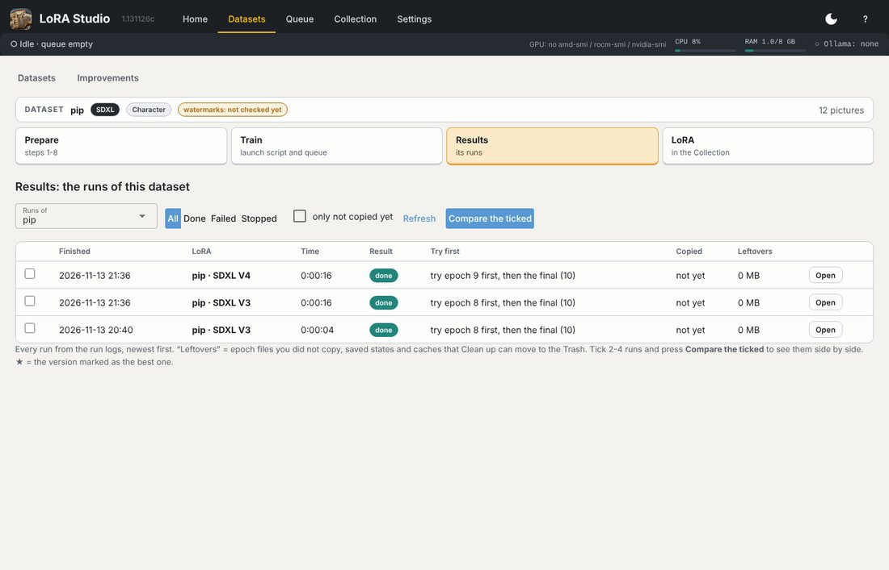
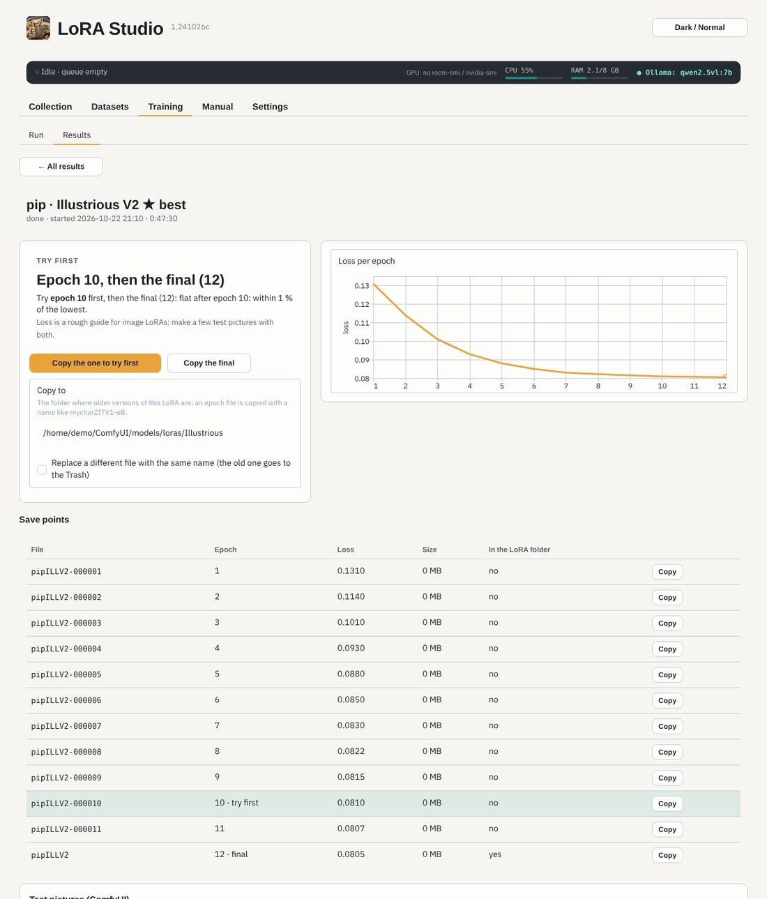

# Results: picking the best version

**Training › Results** lists every finished run, newest first: the result, the save point to try first, whether it is
copied to your LoRA folder, and the leftovers *Clean up* can remove.

## One run

**Try first** is the earliest saved epoch whose loss is within 1 % of the lowest, and it says when the loss rose at the
end (trained too long) or was still falling (could train longer). Loss is only a rough guide for image LoRAs: make
a few test pictures with it and the final file.

- *Copy the one to try first* / *Copy the final* copies the file into your LoRA folder, with its LoRA Manager data:
  into the folder of its LoRA type (next to an older version when there is one, in a subfolder), never into the LoRA
  folder's root.
- **Test pictures (ComfyUI)**: the same prompts and seeds with several save points side by side; *Use this one*
  copies that save point and makes its first picture the preview.
- **Clean up this run** moves epoch files you did not copy, saved states and caches to the Trash.
- **This run**: *Train a new version…* opens Datasets › 9 Train for the dataset; *Run it again* puts the same
  script in the queue; *★ Best version* marks it; *Report for Claude* makes the report file (see [Training](#training)).
- **TensorBoard** (folded): *Start TensorBoard* opens the run's logs in TensorBoard; *End of the run log* shows the
  last lines as the trainer wrote them.

## Comparing versions

Tick two to four runs and press **Compare the ticked**.

The loss curves in one chart, the settings that differ, and the test pictures side by side (*Make test pictures with
the same prompts* gives every run the same prompts and seeds). **★ Mark as the best version**: the Collection then
shows that version first, even when a newer one exists.

> **Do** compare two versions that differ in one or two settings: then you know what made the difference.
