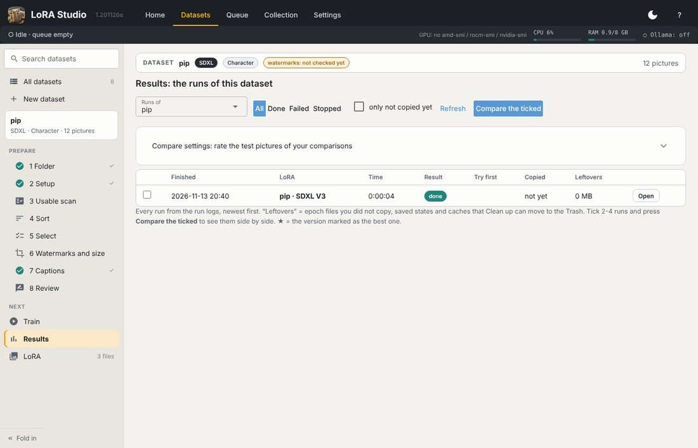
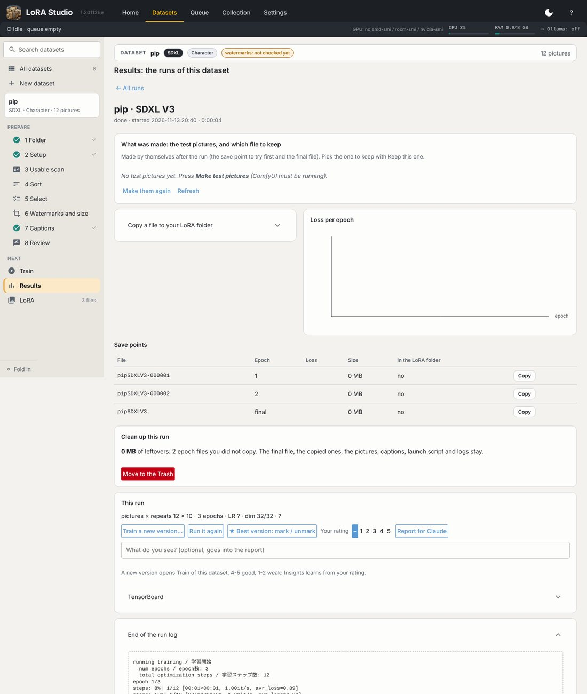
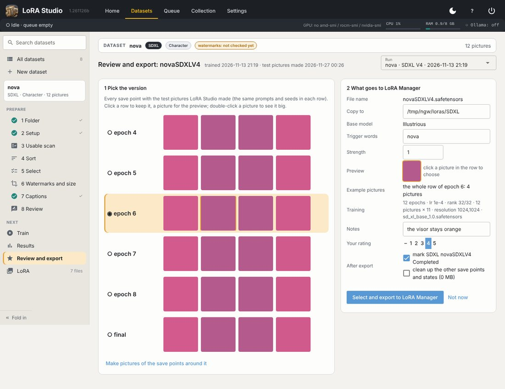
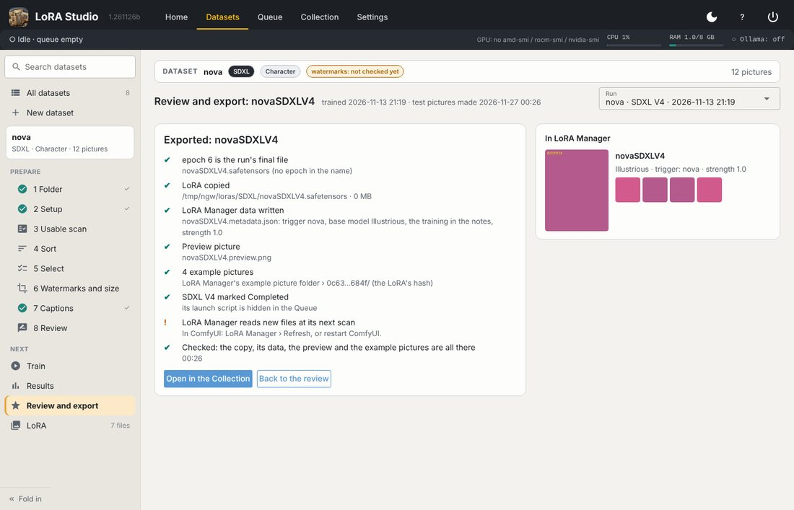
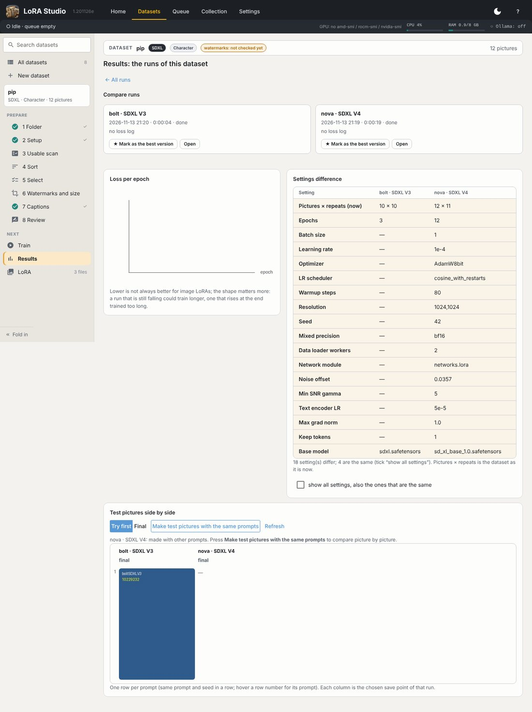
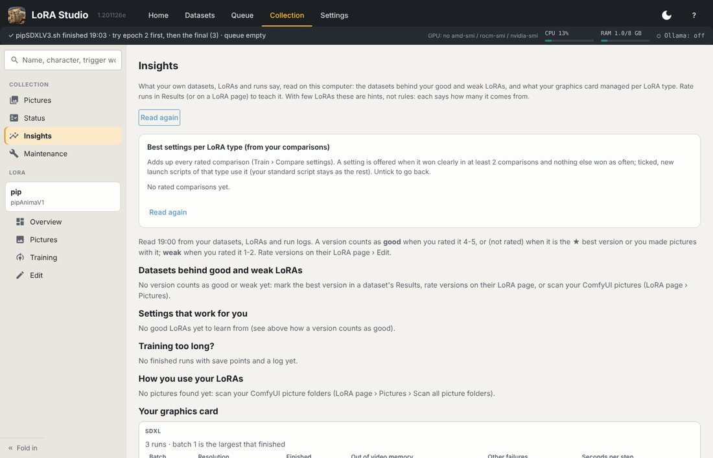

# Results: picking the best version

A dataset page's **Results** part lists the finished runs of that dataset, newest first (*Runs of* shows another
dataset's or all runs): the result, the save point to try first, whether it is
copied to your LoRA folder, and the leftovers *Clean up* can remove.

## One run

**Review and export →** opens the run's test pictures, where you pick the save point to keep and export it to LoRA
Manager (see [Review and export](#results) below). *Make the test pictures* makes them when ComfyUI was off.

**Try first** is the earliest saved epoch whose loss is within 1 % of the lowest, and it says when the loss rose at the
end (trained too long) or was still falling (could train longer). Loss is only a rough guide for image LoRAs: make
a few test pictures with it and the final file.

- **Save points**: every file of the run with its loss, size and whether it is in your LoRA folder.
- **Clean up this run** moves epoch files you did not copy, saved states and caches to the Trash.
- **This run**: *Train a new version…* opens the dataset's Train part; *Run it again* puts the same
  script in the queue; *★ Best version* marks it; *Your rating* (4-5 good, 1-2 weak) teaches Insights; *Report for Claude* makes the report file (see [Training](#training)).
- **TensorBoard** (folded): *Start TensorBoard* opens the run's logs in TensorBoard; *End of the run log* shows the
  last lines as the trainer wrote them.

## Review and export (to LoRA Manager)

When a run's test pictures are made, the status strip (*→ Review and export*) and Home's **Just trained** open this
part of the dataset page; the left menu has it under *Next*. *Run* picks another run of the dataset.

1. **Pick the version**: one row per save point, the same prompts and seeds in each row (*★ try first* marks the
   suggested one). Click a row to keep it, a picture to make it the preview; double-click a picture to see it big.
   *Make pictures of the save points around it* adds the save points on each side of the suggested one (pictures that
   are already there are not made again).
2. **What goes to LoRA Manager**: the file name (always the run's name, never with the epoch in it), the folder it is
   copied to (the folder of its LoRA type, next to an older version), the base model, the trigger words, the strength
   (LoRA Manager's usage tips), the preview, the example pictures (the whole row of the chosen save point), the
   training, your note and your rating. *After export*: mark the version Completed (on), and clean up the other save
   points and resume states of the run (off; they go to the Trash).
3. **Select and export to LoRA Manager**: the chosen save point becomes the run's final file (the old final file stays
   as its own save point, unless you clean up), it is copied into your LoRA folder with `<name>.metadata.json`
   and `<name>.preview.png` next to it, and the row's pictures go into LoRA Manager's example picture folder (its
   setting *example_images_path*, one folder per LoRA hash) with their prompt and seed. The dataset's LoRA card in the
   Collection gets the same data.

The list says what was done and checks it at the end (the copy, its data, the preview and the example pictures).
LoRA Manager reads the new files at its next scan: *Refresh* in LoRA Manager, or restart ComfyUI. When LoRA Manager's
example picture folder is not known, set it in Collection › Maintenance; the LoRA and its data are exported anyway.

## Comparing versions

Tick two to four runs and press **Compare the ticked**.

The loss curves in one chart, the settings that differ, and the test pictures side by side (*Make test pictures with
the same prompts* gives every run the same prompts and seeds). **★ Mark as the best version**: the Collection then
shows that version first, even when a newer one exists.

> **Do** compare two versions that differ in one or two settings: then you know what made the difference.

## Compare settings (which settings make the best LoRA of a type)

**Start** (dataset page › Train › *Compare settings*): tick what to compare and press *Start the comparison*. Every
run starts from your standard launch script of the chosen LoRA type with ONE setting changed:

- **Learning rate**: the two of 5e-5, 1e-4 and 2e-4 your script does not use;
- **Rank**: the two of 16/16, 32/32 and 64/64 your script does not use;
- **Text encoders**: trained (5e-5) when your script trains the image model only, and the other way round;
- **Steps / epochs**: no extra run; the save points of your standard script at about half and three quarters of the
  way are compared with its final file.

The card lists the runs and, after a speed test of the type, about how many hours they take; everything ticked is
six trainings, so start it in the evening. The runs train into `_compare/` in the dataset folder (the Collection skips
it) and wait in the queue as one group. When the queue is done, every run gets the same 6 test pictures (3 captions
of the dataset × 2 seeds) through ComfyUI, made by themselves (or *Make pictures*).

**Rate** (Results › *Compare settings*, or the phone page's *Rate the pictures*): each row is one prompt and seed with
the picture of every run, shuffled and named A, B, C …; tap the best (or two). *None are good* and *All look the
same* count too. When every row is rated (or with *Show the answers*) the names show and what won: a setting wins
**clearly** with at least 3 picks and twice as many as the next one. *Delete* moves a comparison's scripts, LoRA
files and pictures to the Trash.

**Best settings per LoRA type** (Collection › Insights): every rated comparison added up per type. A setting that won
clearly in at least 2 comparisons, more often than anything else, gets a tick **Use … for new launch scripts**; new
launch scripts of that type then use it (with a comment line saying so). Untick to go back to your standard.

> **Do** compare on two or three different datasets before you tick a winner: one dataset can fool you.

A **settings profile** chosen in step 9 wins over the comparison winners for that dataset. To share a winner, make a
launch script with it and use *Export…* in step 9 (see [step 9](#datasets)).

## Insights (Collection › Insights)

**Insights** compares your own LoRAs, read on this computer. Rate versions on the run's page in Results or on their LoRA page › Edit (*Your rating*:
4-5 good, 1-2 weak; without a rating the ★ best version and versions you made pictures with count as good). Per LoRA
type it shows:

- **Datasets behind good and weak LoRAs**: pictures, repeats, steps, close-ups, full body, outfits, places, detail
  shots, caption length. Step 5 shows what your good LoRAs of the type had.
- **Your graphics card**: the batch sizes that finished, the ones that ran out of video memory, and the seconds per
  step. Step 9 warns when the batch ran out of memory before and estimates the time from your own runs.
- **Settings that work for you**: learning rate, dim / alpha, epochs, steps and optimizer of your good LoRAs next to the
  others; step 9 shows them next to the recommendations.
- **Training too long?**: where in the run the save point to try first was; step 9 suggests fewer epochs when your runs
  usually peaked early.
- **How you use your LoRAs**: pictures made with each, the strength you use, when last, and LoRAs you never used. The
  LoRA page says how often you used a LoRA and offers that strength.

With few LoRAs these are hints, not rules: each says how many LoRAs it comes from. *Read again* after new runs.
