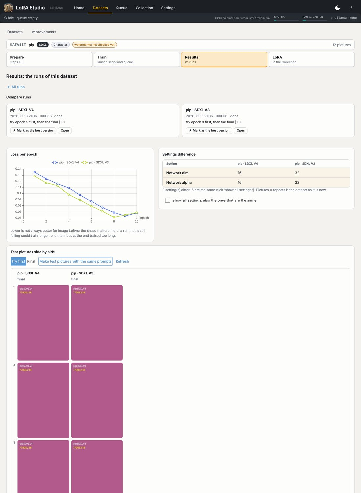
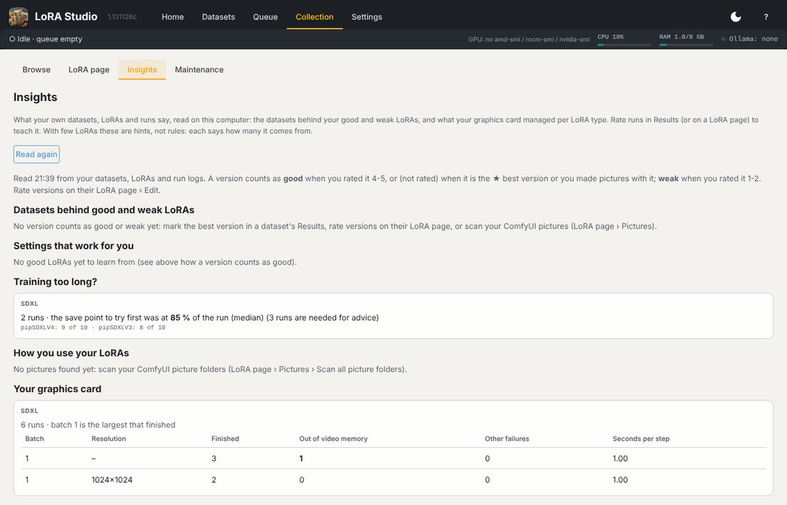

# Results: picking the best version

A dataset page's **Results** part lists the finished runs of that dataset, newest first (*Runs of* shows another
dataset's or all runs): the result, the save point to try first, whether it is
copied to your LoRA folder, and the leftovers *Clean up* can remove.

## One run

**Try first** is the earliest saved epoch whose loss is within 1 % of the lowest, and it says when the loss rose at the
end (trained too long) or was still falling (could train longer). Loss is only a rough guide for image LoRAs: make
a few test pictures with it and the final file.

- *Copy the one to try first* / *Copy the final* copies the file into your LoRA folder, with its LoRA Manager data:
  into the folder of its LoRA type (next to an older version when there is one, in a subfolder), never into the LoRA
  folder's root.
- **Test pictures (ComfyUI)**: the same prompts and seeds with several save points side by side; *Use this one*
  copies that save point and makes its first picture the preview.
- **Clean up this run** moves epoch files you did not copy, saved states and caches to the Trash.
- **This run**: *Train a new version…* opens the dataset's Train part; *Run it again* puts the same
  script in the queue; *★ Best version* marks it; *Your rating* (4-5 good, 1-2 weak) teaches Insights; *Report for Claude* makes the report file (see [Training](#training)).
- **TensorBoard** (folded): *Start TensorBoard* opens the run's logs in TensorBoard; *End of the run log* shows the
  last lines as the trainer wrote them.

When a run or a queue has just ended, Home's **Just trained** card leads straight to these test pictures (see
[Welcome](#welcome)).

## Comparing versions

Tick two to four runs and press **Compare the ticked**.

The loss curves in one chart, the settings that differ, and the test pictures side by side (*Make test pictures with
the same prompts* gives every run the same prompts and seeds). **★ Mark as the best version**: the Collection then
shows that version first, even when a newer one exists.

> **Do** compare two versions that differ in one or two settings: then you know what made the difference.

## Insights (Collection › Insights)

**Insights** compares your own LoRAs, read on this computer. Rate versions on the run's page in Results or on their LoRA page › Edit (*Your rating*:
4-5 good, 1-2 weak; without a rating the ★ best version and versions you made pictures with count as good). Per LoRA
type it shows:

- **Datasets behind good and weak LoRAs**: pictures, repeats, steps, close-ups, full body, outfits, places, detail
  shots, caption length. Step 5 shows what your good LoRAs of the type had.
- **Your graphics card**: the batch sizes that finished, the ones that ran out of video memory, and the seconds per
  step. Step 9 warns when the batch ran out of memory before and estimates the time from your own runs.
- **Settings that work for you**: learning rate, dim / alpha, epochs, steps and optimizer of your good LoRAs next to the
  others; step 9 shows them next to the recommendations.
- **Training too long?**: where in the run the save point to try first was; step 9 suggests fewer epochs when your runs
  usually peaked early.
- **How you use your LoRAs**: pictures made with each, the strength you use, when last, and LoRAs you never used. The
  LoRA page says how often you used a LoRA and offers that strength.

With few LoRAs these are hints, not rules: each says how many LoRAs it comes from. *Read again* after new runs.
