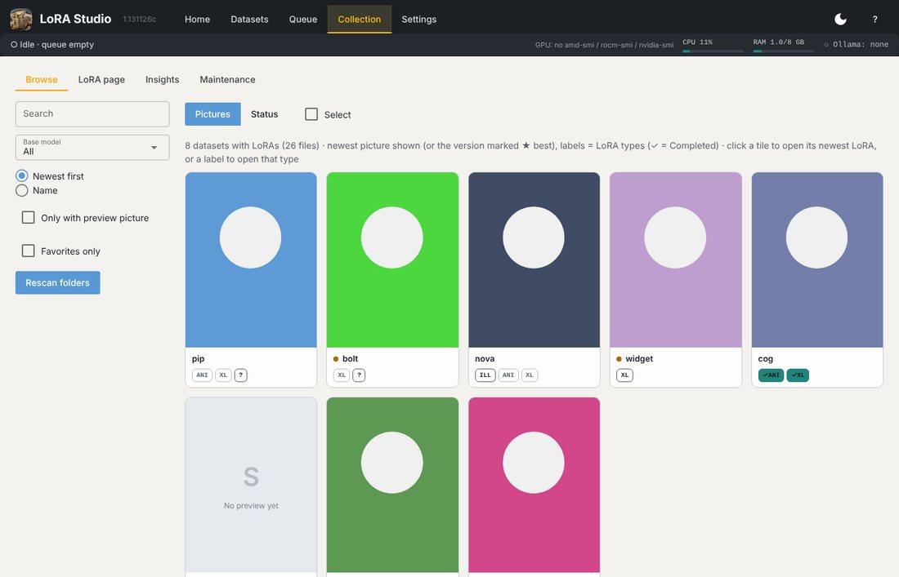
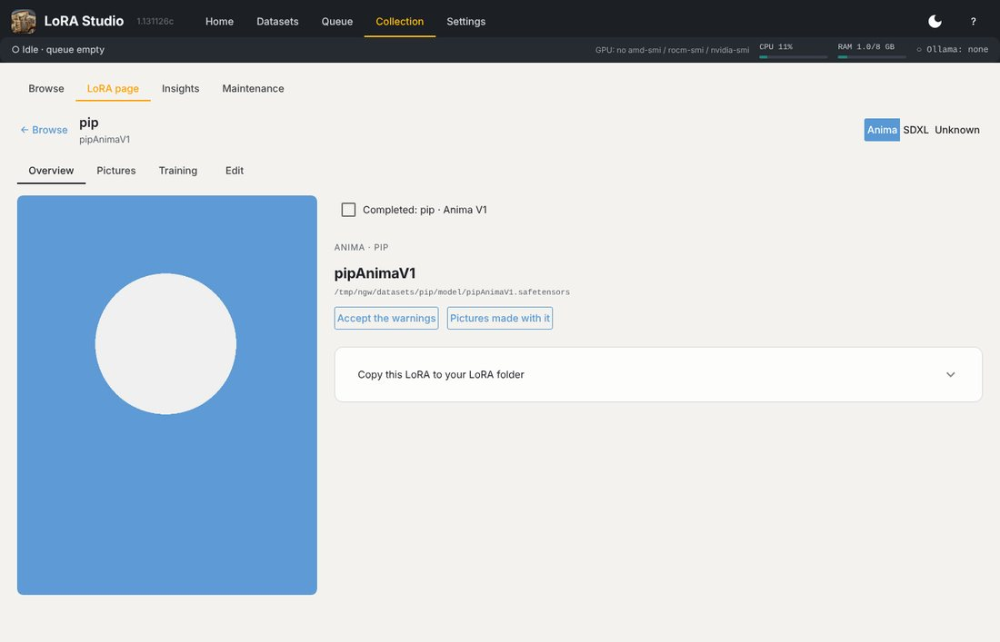
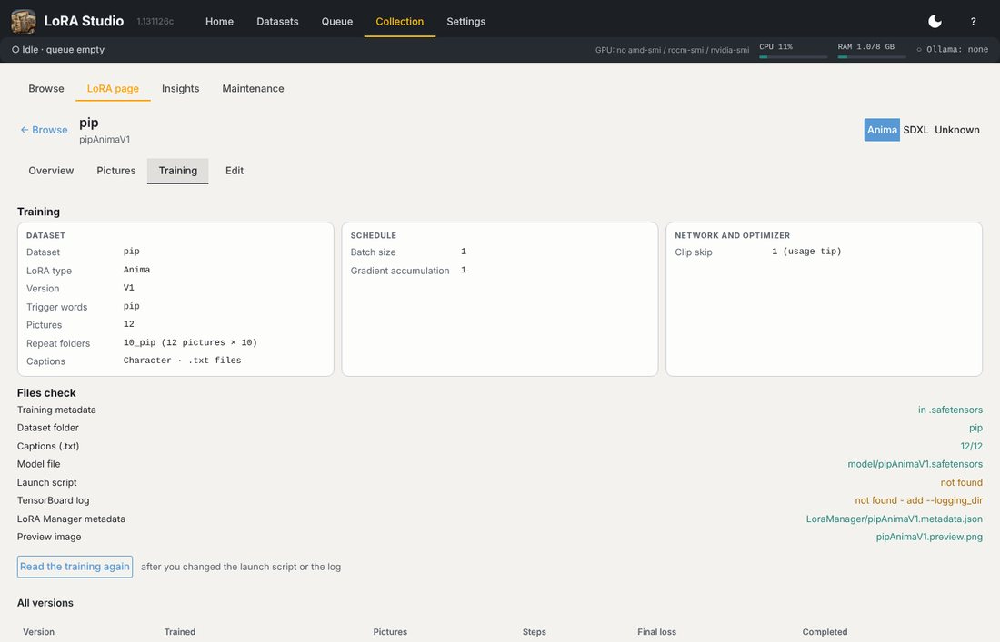
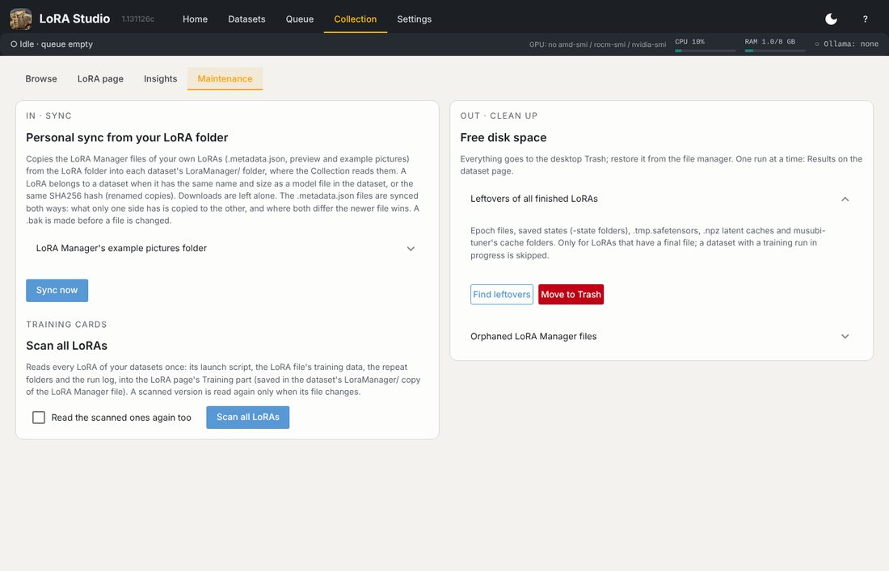

# The Collection

The Collection has four pages: **Browse**, **LoRA page**, **Insights** (see [Results](#results)) and **Maintenance**.

## Browse

One tile per dataset with the picture of its newest (or ★ best) LoRA, and a label per LoRA type (✓ = Completed). With
*Colour the Collection cards by purpose* on (Settings › Look and base models), each card has a border and a label in
the colour of its purpose (character, art style, object, worn item, action / pose, concept). A click on a tile opens
the dataset page at its **LoRA** part (its LoRAs, with *Open the LoRA page*); a click on a type label on the tile opens
that LoRA page directly.

- **Search** by name, character or trigger word; filter by **Base model**; sort *Newest first* or by *Name*;
  *Only with preview picture*, *Favorites only*.
- **Pictures / Status**: the tiles, or a list with the warnings and problems of the LoRA files themselves (what a
  dataset still needs is in Datasets › Improvements).
- **Select**: tick tiles (or *Select all shown*), then *✓ Mark Completed* or *Mark not completed*. **Completed** marks a
  version as finished: its launch script is hidden in the Queue. A new version starts unmarked.
- *Rescan folders* reads your LoRA folders again (new or removed files).

## The LoRA page

Click a tile for its **LoRA page**; the *Version* menu at the top switches between the versions.

- **Overview**: the preview picture (the one you chose in LoRA Manager; NSFW blur follows Settings › Look and base
  models), the versions, the trigger words with the Character description, how often you used the LoRA in your
  pictures and at which strength, and **LoRA Manager's example pictures** (the ones you added on its card, linked by
  *Sync now*; the tile says how many there are). *Accept the warnings* hides a warning you have looked at (for example
  *Run stopped at epoch 8 of 10* when you stopped it on purpose); press again to see it again. *Copy this LoRA to your
  LoRA folder* copies a version there, into the folder of its LoRA type.
- **Pictures**: every picture you made with this LoRA, all its versions together, found through the `.json` ComfyUI
  saves next to each picture (or the PNG's own metadata), with its prompt; *◀ Newer* / *Older ▶* page through them.
  *Scan for new pictures* reads only new and changed pictures, *Scan all picture folders* all of them. **Old names
  of this LoRA**: names found in your pictures that no LoRA file has now but that look like this LoRA (a rename): tick
  them and their pictures join.
- **Training**: what the version was trained with, in separate fields: the dataset and its repeat folders, epochs and
  how the steps add up, the network and optimizer settings, and the result (training time, final loss, the save point
  to try first). They are read from the LoRA file, its launch script and its logs, once per version; *Read the
  training again* after you changed the script or the log. *Train a new version…* opens the dataset's Train part.
- **Edit**: display name, character (groups it in Browse), version (shown in ComfyUI's LoRA Manager), clip skip,
  **Your rating** (4-5 good, 1-2 weak, for Collection › Insights; the same rating as on the run's page in Results), trigger words, description, notes, strength and CLIP strength,
  the preview's NSFW level, favorite, and a flag with its reason. Saved in LoRA Manager's format in the dataset's
  `LoraManager/` folder (a `.bak` is kept).

## Maintenance

- **Sync now**: copies the LoRA Manager files of your own LoRAs (`.metadata.json`, preview, example pictures) between
  the LoRA folder and each dataset's `LoraManager/` folder, where the Collection reads them. A LoRA belongs to a
  dataset when it has the same name and size as a model file in the dataset, or the same SHA256 (renamed copies). It
  works both ways: what only one side has (notes, tags, trigger words, Civitai data) is copied to the other, an empty
  field takes the other side's value, and where both differ the newer file wins. The version name always comes from
  LoRA Studio, trigger words come from LoRA Manager when LoRA Studio has none, and with no clip skip anywhere both get
  1. A `.bak` is made before a file is changed.
- **LoRA Manager's example pictures folder**: where LoRA Manager keeps the pictures you add to a LoRA's card; empty =
  read from LoRA Manager's own settings. They are linked, not copied.
- **Scan all LoRAs**: reads every LoRA of your datasets once (launch script, the LoRA file's training data, repeat
  folders, run log) into the fields of the LoRA page's Training tab. A scanned version is read again only when its file changes; tick
  *Read the scanned ones again too* to read them all.
- **Free disk space**: *Leftovers of all finished LoRAs* (epoch files, saved states, `.tmp.safetensors`, latent caches,
  musubi-tuner's caches, only for LoRAs with a final file; *Find leftovers*, tick *Yes*, *Move to Trash*) and
  **Orphaned LoRA Manager files** (a `.metadata.json` with its pictures whose LoRA file is gone). Everything goes to the
  desktop Trash.
