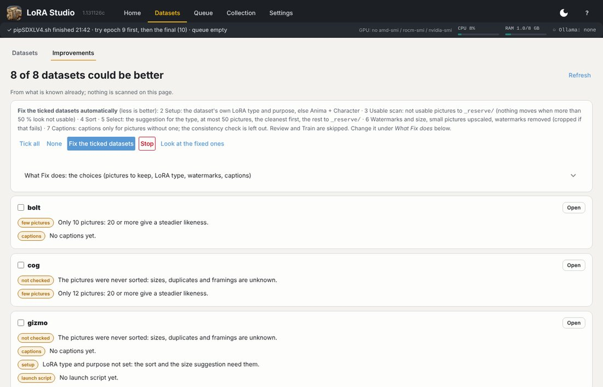
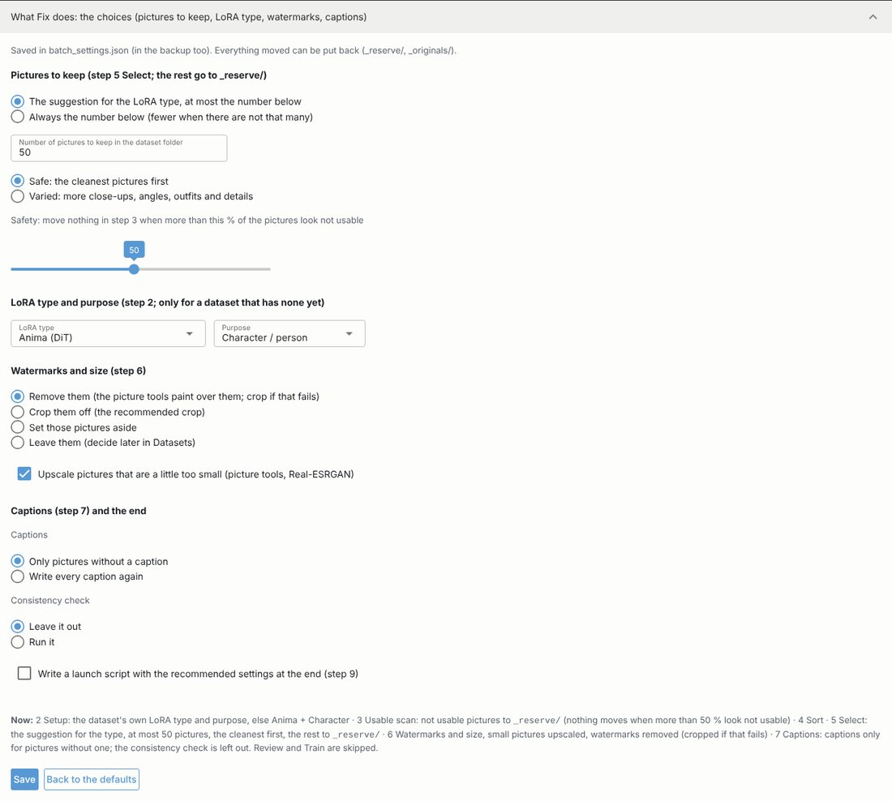

# Automatic improvement

**Datasets › Improvements** lists what could be better in each dataset, from what is known already (nothing is
scanned there): too many pictures, no full-body pictures, the balance of outfits and places, the detailed scan's gaps,
missing captions, watermarks not decided, no launch script. It judges **only the pictures in the repeat folder**
(`10_<name>/`): that is what trains. Pictures in `_reserve/` and other folders are not counted; they are only named as
the place to find what is missing ("2 are in _reserve: put them back in step 5"). Pictures added to the repeat
folder after the sort are listed as not checked yet.

Each dataset has its own card. A note about particular pictures has **Show the pictures** under it (the pictures
not checked yet, the ones with the same outfit or place, the ones waiting for your pick). **The same outfit or
place in most pictures** is only reported when the captions do not name it: when they do (for example the tag
`leather jacket` in most of them), the trigger word does not take it over and there is nothing to fix.

*Fix the ticked datasets* runs steps 2 to 7 for each ticked dataset in the background, with the choices in
**What Fix does** (the folded section on the same page):

The settings are grouped like the steps: **Pictures to keep** (step 5; the rest go to `_reserve/`), **LoRA type and
purpose** (step 2, only for a dataset that has none yet), **Watermarks and size** (step 6) and **Captions** (step 7)
with what happens at the end. For a character with the detailed scan on, Fix then looks through **your own
pictures made with the dataset's LoRA** (and no other LoRA) for the gaps, as *Fill the gaps* in step 5 does, but it
makes nothing new: what it finds waits in step 5 for your pick, and the card says how many. Your step 5 pins count
here too. Everything it moves can be put back (`_reserve/`,
`_originals/`); *Back to the defaults* resets the choices.

> **Do** look at the result of an automatic run once (step 5 and step 8) before training on it.
> **Don't** let it run on a dataset you are editing by hand at the same time.

**Look at the fixed ones** opens the datasets that were fixed one by one at step 5 (Select), so you can look
them over before training.
