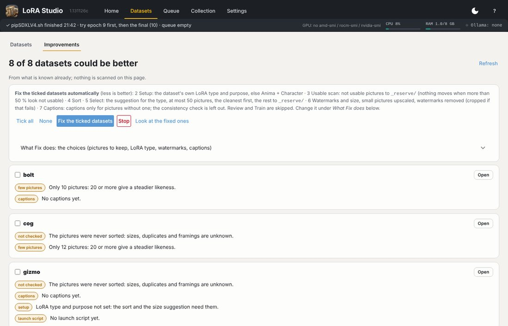
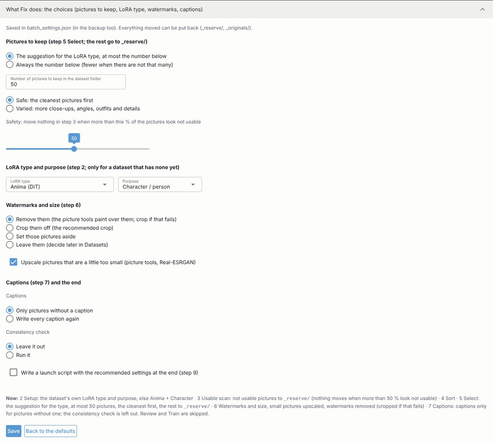

# Automatic improvement

**Datasets › Improvements** lists what could be better in each dataset, from what is known already (nothing is
scanned there): too many pictures, no full-body pictures, missing captions, watermarks not decided, no launch script.

*Fix the ticked datasets* runs steps 2 to 7 for each ticked dataset in the background, with the choices in
**What Fix does** (the folded section on the same page):

The settings are grouped like the steps: **Pictures to keep** (step 5; the rest go to `_reserve/`), **LoRA type and
purpose** (step 2, only for a dataset that has none yet), **Watermarks and size** (step 6) and **Captions** (step 7)
with what happens at the end. Your step 5 pins count here too. Everything it moves can be put back (`_reserve/`,
`_originals/`); *Back to the defaults* resets the choices.

> **Do** look at the result of an automatic run once (step 5 and step 8) before training on it.
> **Don't** let it run on a dataset you are editing by hand at the same time.

**Look at the fixed ones** opens the datasets that were fixed one by one at step 5 (Select), so you can look
them over before training.
