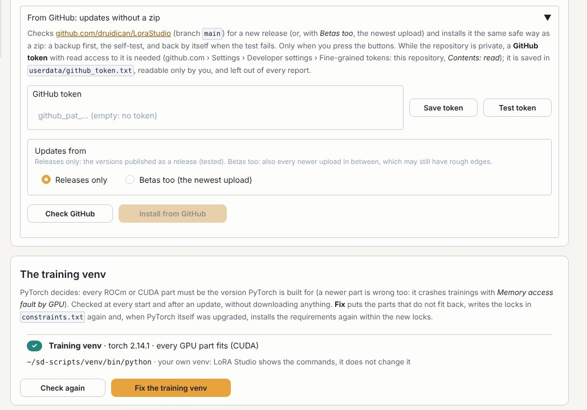

# Updates, backups and the machine check

## Settings › Version

The program version is `release.ddmmyy` and a letter for an update (1.011126 = release 1 of 1 Nov 2026; 1.011126b =
an update of it). Every part keeps the version of the update that last changed it, so you see what an update
changed. A part that is not the one of this release gets a warning (usually a file left behind by a half-done copy).

**Check this machine** looks at the GPU, the trainers and their venv, the model files of every LoRA type, Ollama,
ComfyUI and the picture tools. *Check (no training)* takes about a minute; *Check + tiny training* also trains a tiny
10-step LoRA on made-up pictures to see that training really works. It writes `userdata/lorastudio_check_<time>.md`:
the file to send when something is wrong. **Report for Claude** makes one file about the last run (see
[Training](#training)). **Licences and credits**: LoRA Studio's licence (GPL-3.0-only) and the notice about
sd-scripts and musubi-tuner.

## Settings › Updates

**LoRA Studio itself**: pick a newer LoraStudio.zip. The list shows which parts change and what the update says.
*Install this update* writes only the program files (your settings, token, databases, logs and venv are never
touched), keeps a backup of what it replaces in `update_backups/`, runs the self-test, and puts the old files back
by itself when the test fails. It refuses while a training run, the queue or the automatic improvement is busy.
*Restart LoRA Studio* goes through `start.sh` (new packages get installed) and the page reloads by itself. *Roll back
the last update* brings back the files from before it.

**From GitHub**, without a zip. Under *Updates from*, choose **Releases only** (the default: only versions published
as a release) or **Betas too** (every newer upload in between, which may still have rough edges). *Check GitHub* says
whether there is a newer one, and *Install from GitHub* downloads and installs it the same safe way. Nothing is
checked by itself: only the buttons go online.

While the repository is private, a **GitHub token** is needed. Make one on github.com › Settings › Developer settings
› Personal access tokens › **Fine-grained tokens**: *Only select repositories* › LoraStudio, and under Permissions ›
Repository › **Contents: Read-only**. Copy it with the copy button there, paste it, press *Save token*, then **Test
token**: it says whose token it is and whether it can read the repository's files. When something fails, the
message says which step (reading the newest release, version.py or the download) and what GitHub answered:

| GitHub says | What to do |
|---|---|
| **did not accept the token** | it expired, was revoked or was not copied completely: make a new one |
| **refused** / *Resource not accessible* | the token cannot read the files: give it *Contents: Read-only* for LoraStudio |
| **no release on GitHub yet** | choose *Betas too*, or wait for the first release |
| **limit of requests is used up** | try again after the time it gives |

**The training venv**: every ROCm or CUDA part must be the version PyTorch is built for (a newer part crashes
trainings with *Memory access fault by GPU*). It is checked at every start and after an update, without downloading
anything; **Fix the training venv** puts the parts that do not fit back and renews the locks in `constraints.txt`.
**A newer PyTorch / ROCm**: *Look for a newer PyTorch* asks AMD's server (ROCm) or PyPI (CUDA) which stable builds
exist; *Upgrade* installs it, keeps the old versions in `update_backups/`, tests the GPU and puts them back when the
test fails. A venv of your own is never changed: LoRA Studio shows the commands.

**The trainers**: updates for sd-scripts and musubi-tuner from their GitHub pages (the branch each one is on), checked
quietly at start; *Update now* installs them, tested before and after, rolled back when a test fails. PyTorch is never
changed by it.

## Settings › Backup

A backup is one zip with your settings and LoRA Studio's own databases: folders, model files per LoRA type, Completed
marks, your edits on the LoRA pages, old LoRA names, the picture index, file hashes and training logs, and (ticked) your
Hugging Face token. Your datasets, models, LoRAs and pictures are **not** in it: they stay where they are. *Back up now*
writes it to the backup folder (best one that is copied off this computer). **Restore from a backup**: pick one found
there or give the path of a zip, tick *Yes*, *Restore* (the current settings are kept aside first). A new install can
import a backup on its setup page. Make one before big changes.
