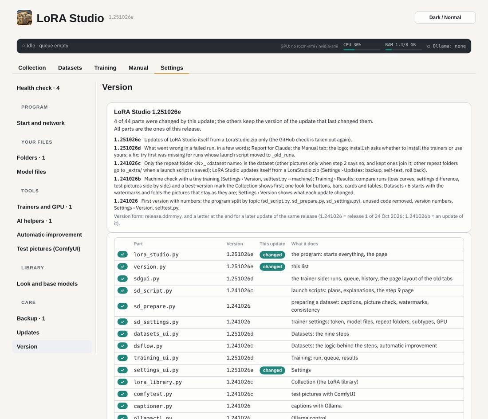
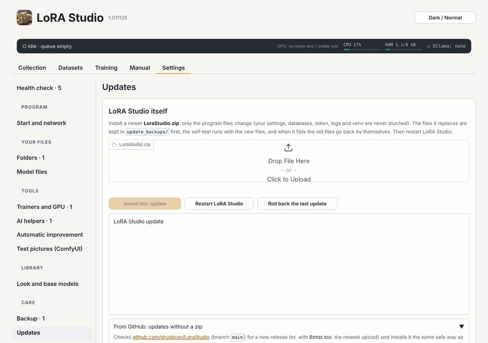

# Versions, updates and the machine check

## Settings › Version

The program version is `release.ddmmyy` and a letter for an update (1.251026d = release 1, an update made on
25 Oct 2026). Every part keeps the version of the update that last changed it, so you see what an update
changed. A part that is not the one of this release gets a warning (usually a file left behind by a half-done copy).

**Check this machine** looks at the GPU, the trainers and their venv, the model files of every LoRA type, Ollama,
ComfyUI and the picture tools, and can train a tiny 10-step LoRA on made-up pictures to see that training really
works. It writes `userdata/lorastudio_check_<time>.md`: the file to send when something is wrong.

## Settings › Updates

**LoRA Studio itself**: pick a newer LoraStudio.zip. The list shows which parts change and what the update says.
*Install this update* writes only the program files (your settings, token, databases, logs and venv are never
touched), keeps a backup of what it replaces in `update_backups/`, runs the self-test, and puts the old files back
by itself when the test fails. It refuses while a training run, the queue or the automatic improvement is busy.

**From GitHub**, without a zip: *Check GitHub* says whether there is a newer upload on GitHub, and *Install from
GitHub* downloads and installs it the same safe way. While the repository is private, save a GitHub token with read
access first (the field above the buttons).
*Restart LoRA Studio* goes through `start.sh` (new packages get installed) and the page reloads by itself.
*Roll back the last update* brings back the files from before it. **The trainers**: updates for sd-scripts and musubi-tuner
from their GitHub pages, tested before and after, rolled back when a test fails.

## Backups

**Settings › Backup** saves your settings, Completed marks and databases (never the LoRAs or pictures). Make one
before big changes.
