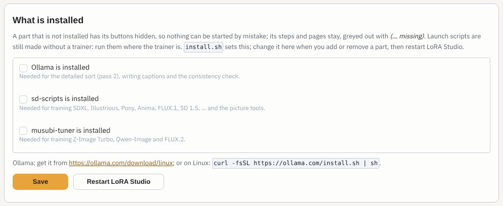
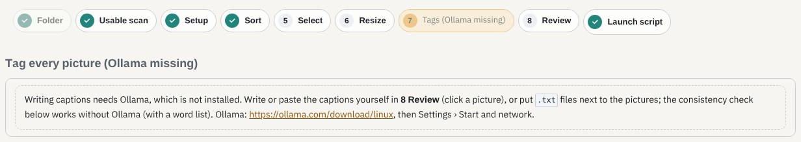
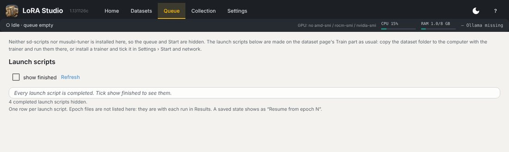

# Installing: Linux, Windows, macOS, what you have

LoRA Studio works with what your computer has. You do not need everything: a part you leave out has its buttons
hidden, and its places are greyed out with **(… missing)** so you can see what it would do.

## The three parts

| Part | What it does | Without it |
|---|---|---|
| **sd-scripts** | trains SDXL, Illustrious, Pony, Anima, FLUX.1, SD 1.5, … | launch scripts are still made; you run them where sd-scripts is |
| **musubi-tuner** | trains Z-Image Turbo, Qwen-Image and FLUX.2 | the same, for those types |
| **Ollama** | the detailed sort (pass 2), writing captions, the AI consistency check | the quick sort, captions you write yourself, the word-list consistency check |

`install.sh` asks about each one: **install it for me**, **I have it already** (it asks for the folder), or
**none**. Ollama can be installed for you on Linux only; on Windows it is installed in Windows (see below).
The answers are remembered; `./install.sh --ask` asks again.

## Python: nothing to install

The installer gives LoRA Studio its **own Python 3.12**, made with the small tool [uv](https://docs.astral.sh/uv/) in
`~/LoraStudio/.tools`: no administrator rights, and the Python of your computer is not touched. It is the same
Python 3.12 on every Linux, in WSL on Windows and on macOS. Only when it cannot be downloaded does the installer use
the computer's own `python3.12`. LoRA Studio's own packages (Gradio and the rest) have no version numbers, so the
newest are installed; the trainers keep the versions they need.

## Linux

```bash
unzip LoraStudio.zip && cd LoraStudio
./install.sh
cd ~/LoraStudio && ./start.sh
```

With a trainer to install, it installs PyTorch for your graphics card: **AMD Radeon** with ROCm, **NVIDIA** with
CUDA. A computer with both (a laptop) is asked which one to train on. With your own trainers, or none, it only makes
a small environment for LoRA Studio itself.

## Windows

LoRA Studio and the trainers are Linux programs. On Windows they run in **WSL2**, Microsoft's Linux inside Windows.
Unpack LoraStudio.zip and double-click **Install LoRA Studio.cmd**:

1. It installs WSL2 with Ubuntu when it is missing. Windows asks for administrator rights; restart Windows,
   choose an Ubuntu user name and password, then double-click the installer again.
2. It looks at your graphics card and at Ollama.
3. It runs the Linux installer inside Ubuntu, with the same three questions.
4. It puts **LoRA Studio** on your desktop: double-click it, and the browser opens when LoRA Studio is ready.
   Closing its black window stops LoRA Studio.

- **NVIDIA**: the normal Windows driver is enough.
- **AMD Radeon**: training in WSL needs AMD's *ROCm on WSL* (Radeon RX 7000/9000 with a recent driver). If your
  card or driver cannot, answer **none** for the trainers: you prepare datasets and make launch scripts on Windows,
  and train on a Linux computer. If training hangs at the very start in WSL on a Ryzen with built-in graphics, turn that
  built-in graphics off in the Windows Device Manager and run `wsl --shutdown`.
- **Ollama**: install it in Windows from [ollama.com/download/windows](https://ollama.com/download/windows)
  ([guide](https://github.com/ollama/ollama/blob/main/docs/windows.md)), then run the installer again (or tick it in
  Settings, below). On Windows 11 the installer offers to let Ubuntu reach it directly.

Your Windows files are in Ubuntu under `/mnt/c` (for example `/mnt/c/Users/you/Pictures`). Datasets inside Ubuntu
train faster; the Explorer shows them under **Linux › Ubuntu-24.04 › home**.

## macOS

A Mac has neither CUDA nor ROCm, so the trainers are not installed there. LoRA Studio itself works: datasets, the sort
and captions (with Ollama), the Collection and the launch scripts, which you run on a Linux or Windows computer.
Unpack LoraStudio.zip, open **Terminal**, go into the unpacked folder (type `cd `, drag the folder in, press Enter) and
run `bash ./install.sh`; start it with `cd ~/LoraStudio && ./start.sh`. Ollama for the Mac:
[ollama.com/download/mac](https://ollama.com/download/mac).

## Adding a part later

Install the part, then open **Settings › Start and network › What is installed**, tick it, **Save** and
**Restart LoRA Studio**. The page is built once at start, so the buttons appear after the restart.



## What a missing part looks like

Without Ollama, step 7 keeps its place as **Tags (Ollama missing)**: the caption buttons are gone, and a note says
what still works.



Without either trainer, **Training › Run** shows the launch scripts but no queue and no Start; each script says which
trainer it needs.



See also [Settings](#settings) and [Training](#training).
